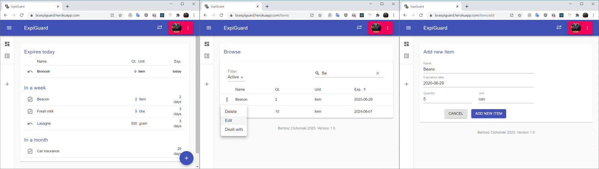

<a href="https://bcexpiguard.herokuapp.com">DEMO</a>

# BcExpiGuard

> Keep things from getting expired, learn React and stuff at the same time

> react, redux, PWA, nodejs, pouchdb, desktop, mobile

---

### Prerequisites

- **Node.js**: This project requires Node.js 24 or later. See [`.nvmrc`](.nvmrc) for the exact version.

---

***Screenshots***

[More](doc/screenshots/)

---

### Clone

- Clone this repo to your local machine using `https://github.com/bcichonski/BcExpiGuard.git`

### Available Scripts

#### In the `main` directory, you can run:

##### `npm start`
to run NodeJS Express server to host the website

##### `npm run build`
to prepare scripts for production

#### In the `react-ui` subdirectory, you can run:

##### `npm start` (or `npm run dev`)

Starts the Vite development server on [http://localhost:3000](http://localhost:3000). The app reloads automatically when you save changes.

##### `npm run build`

Builds the app for production to the `build` folder. The build is minified and optimized for best performance.

##### `npm run preview`

Locally preview the production build on [http://localhost:3000](http://localhost:3000).

##### `npm test`

Runs the test suite once with Vitest.

##### `npm run test:watch`

Runs tests in watch mode.

##### `npm run lint`

Lints the code with ESLint.

### Configuration

Local development and production configuration is managed via environment variables:

1. **Local Development**: Copy `react-ui/.env.example` to `react-ui/.env.local` and customize as needed.
2. **Production**: `react-ui/.env.production` contains the production values.

The following variables are required:

- `VITE_COUCH_URL` — CouchDB server URL (e.g., `https://expiguard.bartq.toh.info/`)
- `VITE_AUTH0_DOMAIN` — Auth0 tenant domain (e.g., `bcexpiguard.eu.auth0.com`)
- `VITE_AUTH0_CLIENT_ID` — Auth0 SPA application client ID
- `VITE_AUTH0_AUDIENCE` — Auth0 API audience (e.g., `https://expiguard.bartq.toh.info`)

---

## Technologies

* Frontend built with [Vite](https://vitejs.dev/) and [React](https://react.dev/) 19
* [React Router](https://reactrouter.com) 7 for routing
* [Redux Toolkit](https://redux-toolkit.js.org) 2 with react-redux 9 for state management
* [date-fns](https://date-fns.org) 4 for dates
* [MUI](https://mui.com) v7 (Material UI, Emotion) with MUI X data grid and date pickers for the UI, [Recharts](https://recharts.org) for charts
* [PouchDb](https://pouchdb.com) / [CouchDb](https://couchdb.apache.org/) for storing data ([server setup notes](doc/couchdb/README.md))
* [Auth0](https://auth0.com) integration (Auth0 React SDK v2) for handling auth-related stuff
* Hosting provided by [Heroku](https://www.heroku.com/)

---

## Team

> Me, Myself & I 

---

## Contact

My old fashioned email is displayed in my github profile page.

## License

- **[MIT license](http://opensource.org/licenses/mit-license.php)**