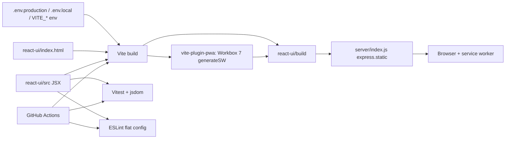
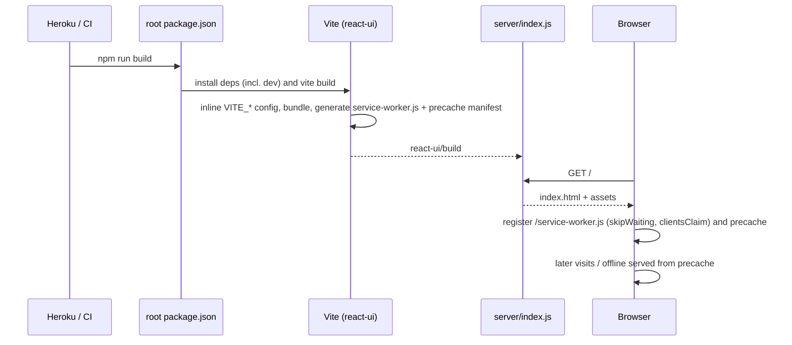

# Modernization Phase 1: Replace Create React App with Vite Plan

**Plan Status**: `FINAL`

**Story Type**: `Internal`

> This plan captures **what** to build and **why** — domain, architecture, decisions, and verified facts.
> It deliberately does **not** contain implementation code, pseudocode, line numbers, mock setups, or test bodies.
> The implementation agent discovers the **how** against live code. See §4 Task Breakdown.

Source: GitHub issue [#26](https://github.com/bcichonski/BcExpiGuard/issues/26) — second phase of the modernization plan. Builds on Phase 0 ([#25](https://github.com/bcichonski/BcExpiGuard/issues/25), merged in PR #33): the Node 24 pin, the Jest characterization suite (8 suites / 118 tests) and the CI workflow are the safety net this phase is checked against.

---

## 1. Problem Statement

*   **Context**: `react-ui/` is built with Create React App (`react-scripts` 3.4.1, webpack 4). CRA is deprecated, needs `NODE_OPTIONS=--openssl-legacy-provider` on current Node, and carries most of the `npm audit` findings. Dependabot PRs #7, #8, #12 and #14 bump `react-scripts` to 5.0.1 and fail to build. Configuration (CouchDB URL, Auth0 settings) is hard-coded in `constants/constants.js` and `constants/auth_config.json`. The PWA uses CRA's Workbox 4 `serviceWorker.js`.
*   **Goal**: Swap the build toolchain to Vite, the test runner to Vitest, the service worker to `vite-plugin-pwa` (Workbox 7), and linting to an ESLint flat config — with the application code (React 16, MUI v4, Redux, PouchDB, Auth0 SPA SDK v1) functionally unchanged.
*   **In scope**: issue tasks 1.1–1.6.
*   **Out of scope**:
    *   Task 1.7 (closing Dependabot #7, #8, #12, #14). Closing other people's/bots' PRs is an outward-facing action that only makes sense once this PR is merged; the PR description lists them for the owner to close after merge.
    *   React / MUI / Redux / router / Auth0 SDK upgrades and any behaviour change (later phases).
    *   Fixing defects pinned by Phase 0 characterization tests.
    *   Server (`server/`) changes beyond what is needed to keep serving the new build.

### 1.1 Technical Summary

*   **Touched projects**: `react-ui` (build config, entry HTML, env config, service worker registration, test config, lint config, JSX file extensions), repo root (`package.json` build script, `README.md`, `.github/workflows/ci.yml`).
*   **New patterns / abstractions**: a single config module reading `import.meta.env` (`VITE_*` variables); PWA registration through `vite-plugin-pwa`'s virtual register module.
*   **Infrastructure changes**: None at runtime. Heroku keeps running `npm run build` at the root and `server/` keeps serving `react-ui/build`.
*   **End-state observable behavior**: `npm run build` in `react-ui` works on Node 24 without flags; `npm test` runs Vitest and the Phase 0 suite stays green; `npm run lint` passes with no errors; the built app installs as a PWA, works offline, and takes over from the old CRA worker on clients that had it.

---

## 2. Architecture & Design

### 2.1 Architecture Overview

#### Involved services & owners

| Service | Technical Owner |
| :--- | :--- |
| `react-ui` (frontend) | repo owner (@bcichonski) |
| `server` (Express static host, unchanged) | repo owner (@bcichonski) |
| GitHub Actions CI | repo owner (@bcichonski) |

#### C2 diagram

#### Flow diagram

### 2.2 External Contracts & Evidence

N/A — Internal story.

### 2.3 Affected Areas

| Area / File (pointer) | Role in this change | Likely action |
| :--- | :--- | :--- |
| `react-ui/package.json`, `react-ui/package-lock.json` | Scripts (`start`/`dev`, `build`, `preview`, `test`, `lint`), dependencies; remove `react-scripts`, `eslintConfig`, `browserslist` (CRA-only). | Change |
| `react-ui/vite.config.*` | Vite + React plugin + PWA plugin + Vitest config. | New |
| `react-ui/public/index.html` → `react-ui/index.html` | Entry HTML; `%PUBLIC_URL%` placeholders become root-relative paths; adds the module script tag. | Move + change |
| `react-ui/src/**/*.js` containing JSX (27 files incl. tests) | Vite 8 only treats `.jsx` as JSX. | Rename to `.jsx` (`git mv`) |
| `react-ui/src/index.js` | Entry; imports `auth_config.json` and `serviceWorker`. | Change (rename + config + PWA registration) |
| `react-ui/src/constants/constants.js`, `react-ui/src/constants/auth_config.json` | Hard-coded CouchDB URL and Auth0 settings. | Change / Delete |
| `react-ui/src/persistence/DbProvider.js` | Consumer of `REMOTE_API_ADDRESS` (concatenated with DB name — trailing slash matters). | Change (import source only) |
| `react-ui/src/common/store.js` | Uses `process.env.NODE_ENV` for Redux devtools. | Change (`import.meta.env`) |
| `react-ui/src/serviceWorker.js` | CRA Workbox 4 registration helper. | Delete |
| `react-ui/public/manifest.json` | PWA manifest; has `"Scope"` instead of `"scope"`. | Change (casing only) |
| `react-ui/src/setupTests.js`, `react-ui/src/tests/**` | Jest setup and Jest-API tests (`jest.fn`, `jest.mock`, `jest.doMock`, fake timers, `getTimerCount`). | Change (port to Vitest) |
| `react-ui/eslint.config.*` | Flat config replacing CRA's `react-app` preset. | New |
| `react-ui/.env.example`, `react-ui/.env.production` | Documented variables; production defaults. | New |
| `react-ui/.gitignore` | Already ignores `/build` and `.env*.local`. | Reference |
| `package.json` (root) | Heroku build script; CRA keywords. | Change |
| `README.md` | Build workaround note, CRA scripts/links. | Change |
| `.github/workflows/ci.yml` | `NODE_OPTIONS` flag and Jest invocation. | Change |
| `server/index.js` | Serves `react-ui/build` and falls back to `index.html`. | Reference (must keep working unchanged) |

### 2.4 Key Algorithms & Behaviour

*   **Output location is a contract.** The build must land in `react-ui/build` (not Vite's default `dist`) because `server/index.js` and Heroku serve that path.
*   **Configuration resolution**: Vite inlines `VITE_*` variables at build time. Precedence (Vite's own): real environment variables > `.env.[mode].local` > `.env.[mode]` > `.env.local` > `.env`. The committed `.env.production` carries today's production values so a Heroku build with no config vars produces the same app as today. Local development uses `.env.local` copied from `.env.example`. `VITE_COUCH_URL` is concatenated with DB names exactly as `REMOTE_API_ADDRESS` was, so the config module must guarantee a single trailing slash. A missing required variable must produce a clear console error naming it, not a silent `undefined` URL; it must not throw at module import (tests import these modules).
*   **Service worker takeover from CRA**: CRA registered `/service-worker.js` at scope `/`. The new worker is emitted under the **same filename**, so the browser treats it as an update of the existing registration rather than a second worker. It activates immediately (`skipWaiting` + `clientsClaim`), removes outdated precaches (Workbox `cleanupOutdatedCaches`), and the page registers it with auto-update. SPA navigation fallback serves `index.html` for app routes (as CRA did), excluding URLs that look like files and `/__`-style paths. Manifest is kept as the hand-written `public/manifest.json` (plugin must not generate a second one).
*   **Tests**: same files, same assertions; only the runner API changes (`jest.*` → `vi.*`, `jest.mock` hoisting → `vi.mock`, `jest.doMock`/`resetModules` → `vi.doMock`/`vi.resetModules`, `getTimerCount` → `vi.getTimerCount`). Assertion counts must not drop — 8 files / 118 tests before and after.
*   **Lint**: the flat config must pass with **zero errors** on the existing code. Rules CRA reported as warnings stay warnings; no code is rewritten to satisfy lint beyond the `eslint-disable` comment adjustments the new rule names require.
*   **PouchDB in the browser**: PouchDB 7 references Node's `global`; Vite does not polyfill it. The build must define it (e.g. map to `globalThis`) or use the browser entry so that the app boots without `global is not defined`.

---

## 3. Key Decisions & Assumptions

*   **Decision — versions**: Vite 8, `@vitejs/plugin-react` 6, `vite-plugin-pwa` 2 (Workbox 7.4), Vitest 5 with jsdom, ESLint **9** (not 10: `eslint-plugin-react` 7.37 declares peer support only up to 9.x), `eslint-plugin-react`, `eslint-plugin-react-hooks`, `globals`. `@testing-library/jest-dom` moves to 6.x (has the `/vitest` entry and still works with the installed `@testing-library/react` 9 / `@testing-library/dom` 7; 7.x requires dom ≥10). Other test libraries stay.
*   **Decision — rename JSX files to `.jsx`** with `git mv` rather than configuring the JSX loader for `.js`. Vite 8 (Rolldown/Oxc) handles JSX by extension; a loader override is fragile across Vite versions. Imports in the codebase are extensionless, so renames need no import edits except for explicit extensions, if any.
*   **Decision — build output stays `react-ui/build`** (`build.outDir`), so `server/` and Heroku need no change.
*   **Decision — committed `.env.production` holds the current production values** (Auth0 domain, client id, audience, CouchDB URL). These are public SPA values already committed in `auth_config.json`/`constants.js`; committing them keeps Heroku builds identical without requiring new Heroku config vars. `.env.example` documents every variable for local dev; `.env.local` stays git-ignored. Root `.gitignore`'s `*.env` does not match `.env.production` or `.env.example`.
*   **Decision — one config module** under `src/constants/` exposes the four values; `auth_config.json` is deleted and `REMOTE_API_ADDRESS` is sourced from it (consumers keep importing a named value).
*   **Decision — root build script installs dev dependencies explicitly** (`npm ci --include=dev` in `react-ui`, then build). Vite is a devDependency; Heroku sets `NODE_ENV=production`, under which a plain `npm install` would skip devDependencies and break the deploy. `npm ci` also uses the lockfile as CI does.
*   **Decision — dev server port 3000** (CRA's port, documented in README) to keep the Auth0 allowed-callback URLs for local dev valid.
*   **Decision — `npm start` stays the dev-server command** (plus `dev` alias) so README instructions keep their shape; `npm test` runs Vitest once (`vitest run`), `test:watch` for watch mode.
*   **Decision — CI** drops `NODE_OPTIONS`, runs `npm test` (Vitest) and adds `npm run lint`.
*   **Decision — service worker filename `service-worker.js`**, `registerType: 'autoUpdate'`, `skipWaiting` + `clientsClaim` + `cleanupOutdatedCaches` (issue's Risk section).
*   **Decision — task 1.7 is not executed by the agent** (see §1 Out of scope).
*   **Assumption — upgrade path test** is done locally with Playwright against the old CRA production build (built from `origin/master` at 81c76b5) followed by the new build on the same origin, not against the live production site (not reachable / not ours to touch). Low risk: same origin + same worker URL is the mechanism that matters and is reproducible locally.

### 3.1 Decision Lock (Constants & Policies)

| Constant / Policy | Selected Value | Why | Where it lives |
| :--- | :--- | :--- | :--- |
| Build output dir | `build` | `server/index.js` serves `react-ui/build` | Vite config |
| Env var names | `VITE_COUCH_URL`, `VITE_AUTH0_DOMAIN`, `VITE_AUTH0_CLIENT_ID`, `VITE_AUTH0_AUDIENCE` | Issue AC | config module, `.env.*` |
| Production values | `https://expiguard.bartq.toh.info/`, `bcexpiguard.eu.auth0.com`, client id from `auth_config.json`, `https://expiguard.bartq.toh.info` | Today's hard-coded values | `.env.production` |
| SW filename / scope | `service-worker.js` / `/` | Take over CRA's registration | PWA plugin config |
| SW lifecycle | `skipWaiting`, `clientsClaim`, `cleanupOutdatedCaches`, auto-update | Issue Risk section | PWA plugin config |
| Manifest | existing `public/manifest.json`, `"scope"` lowercase | Issue AC | `public/manifest.json` |
| Dev port | `3000` | Keep Auth0 local callback | Vite config |
| ESLint major | 9 | `eslint-plugin-react` peer range | `react-ui/package.json` |
| Test count floor | 8 files / 118 tests | Phase 0 baseline | Vitest run |

### 3.2 Open Questions

No open questions.

---

## 4. Task Breakdown

Tasks are sequential: they all edit `react-ui/package.json`, its lockfile and the Vite config, so running them in parallel would conflict.

| Task | Title | Depends on | Complexity |
| :--- | :--- | :--- | :--- |
| `T1` | Vite build replaces react-scripts | — | `High` |
| `T2` | Configuration from `VITE_*` env vars | `T1` | `Low` |
| `T3` | PWA via vite-plugin-pwa (Workbox 7) | `T2` | `High` |
| `T4` | Jest → Vitest + jsdom | `T3` | `Medium` |
| `T5` | ESLint flat config | `T4` | `Medium` |
| `T6` | Root build script, CI workflow and README | `T5` | `Low` |

### T1 — Vite build replaces react-scripts

*   **Goal**: `npm run build` in `react-ui` produces a working app in `react-ui/build` with Vite on Node 24 and no flags; `react-scripts` is gone.
*   **Depends on**: —
*   **Complexity**: `High` — the base every other task rests on; CJS interop (MUI v4 lab/pickers, `material-table`, PouchDB `global`) can fail only at runtime in the browser.
*   **Pointers**: `react-ui/package.json`, `react-ui/public/index.html`, `react-ui/src/**` (JSX files), `react-ui/src/index.js`, `react-ui/src/common/store.js`, `server/index.js` (reference).
*   **Definition of Done**:
    *   Vite + `@vitejs/plugin-react` installed; `react-scripts`, `eslintConfig` and `browserslist` removed from `package.json`; scripts `start`/`dev`, `build`, `preview` exist (test/lint scripts may be temporarily absent; T4/T5 add them).
    *   `index.html` lives at `react-ui/index.html` with root-relative asset links and a module script to the entry; `public/index.html` removed.
    *   Every source and test file containing JSX renamed to `.jsx` via `git mv`.
    *   `process.env.NODE_ENV` usages in `src` switched to Vite equivalents. The CRA `serviceWorker` import may stay for now only if it builds; T3 removes it.
    *   Build output in `react-ui/build`; dev server on port 3000.
    *   App boots in a real browser (Playwright/Chromium against `vite preview` or `node server` with `NODE_ENV` unset): landing page renders, no uncaught errors in the console (`global is not defined` etc.).
*   **Tests expected**: none new. The build must succeed; the existing Jest suite may be temporarily non-runnable (T4 restores it) — note it in the task result.

### T2 — Configuration from `VITE_*` env vars

*   **Goal**: The CouchDB URL and Auth0 settings come from `VITE_COUCH_URL`, `VITE_AUTH0_DOMAIN`, `VITE_AUTH0_CLIENT_ID`, `VITE_AUTH0_AUDIENCE`.
*   **Depends on**: `T1`
*   **Complexity**: `Low`
*   **Pointers**: `react-ui/src/constants/constants.js`, `react-ui/src/constants/auth_config.json`, `react-ui/src/index.jsx`, `react-ui/src/persistence/DbProvider.js`.
*   **Definition of Done**:
    *   A config module reads the four variables; the CouchDB URL is normalized to exactly one trailing slash; a missing variable logs a console error naming it (no throw at import).
    *   `auth_config.json` deleted; `index` and `DbProvider` take their values from the config module.
    *   `.env.example` (all four, with comments; placeholder or current values) and `.env.production` (current production values per §3.1) committed in `react-ui/`.
    *   A production build contains the same URLs/ids as today (grep the built JS).
*   **Tests expected**: unit test for the config module — trailing-slash normalization (with and without slash) and the missing-variable error path. May be written against Vitest only after T4; if T4 is not done yet, add the test in T4's wave instead and say so.

### T3 — PWA via vite-plugin-pwa (Workbox 7)

*   **Goal**: The built app installs as a PWA, works offline, and its worker replaces the old CRA worker on existing clients.
*   **Depends on**: `T2`
*   **Complexity**: `High` — a wrong worker config can strand users on a stale cache with no recovery path.
*   **Pointers**: `react-ui/src/serviceWorker.js`, `react-ui/src/index.jsx`, `react-ui/public/manifest.json`, Vite config.
*   **Definition of Done**:
    *   `vite-plugin-pwa` (generateSW, Workbox 7) configured per §3.1: worker file `service-worker.js`, `skipWaiting`, `clientsClaim`, `cleanupOutdatedCaches`, auto-update registration, SPA navigation fallback to `index.html` (excluding file-like URLs), precache covering the built assets and `public/` icons; plugin does not emit its own manifest.
    *   `src/serviceWorker.js` deleted; registration done from the entry through the plugin's register module.
    *   `manifest.json` content unchanged except `"Scope"` → `"scope"`.
    *   Verified with Playwright/Chromium against `node server` serving `react-ui/build` (HTTP on localhost; the server's HTTPS redirect only applies via `req.secure`/proxy — use whatever local setup serves the build, e.g. `vite preview`, if the redirect gets in the way): worker registers and controls the page; after going offline a reload still renders the app shell.
    *   Upgrade check: serve an old CRA production build (built from `origin/master`), load it so its worker installs, swap in the new build on the same origin, reload — the new worker takes control without manual unregistering and the old Workbox 4 precache is removed. Report the result; the Playwright script itself does not need to be committed.
*   **Tests expected**: no unit tests (worker is generated). The Playwright checks above are the verification.

### T4 — Jest → Vitest + jsdom

*   **Goal**: `npm test` runs the Phase 0 suite under Vitest with the same coverage of behaviour.
*   **Depends on**: `T3`
*   **Complexity**: `Medium` — module mocking and fake-timer semantics differ subtly (`syncMonkey` tests rely on module reset + `doMock` and timer counts).
*   **Pointers**: `react-ui/src/setupTests.js`, `react-ui/src/tests/**`, Vite config (`test` block).
*   **Definition of Done**:
    *   Vitest + jsdom installed; `test` runs once (`vitest run`), `test:watch` watches.
    *   `setupTests.js` loads jest-dom matchers for Vitest (`@testing-library/jest-dom` 6.x).
    *   All `jest.*` usages ported to `vi.*`; no Jest packages or globals left.
    *   Vitest supplies test values for the `VITE_*` variables so tests never depend on `.env.production`.
    *   ≥ 8 test files / ≥ 118 tests, all passing (plus the T2 config test if it lands here).
*   **Tests expected**: the existing suite ported; assertion intent unchanged.

### T5 — ESLint flat config

*   **Goal**: `npm run lint` lints `src` with a flat config equivalent in spirit to CRA's `react-app` preset.
*   **Depends on**: `T4`
*   **Complexity**: `Medium`
*   **Pointers**: `react-ui/eslint.config.*`, `react-ui/package.json`, existing `eslint-disable` comments in `src/common/auth0.js` and `src/index.jsx`.
*   **Definition of Done**:
    *   ESLint 9 + `eslint-plugin-react` (recommended + JSX runtime as appropriate for React 16's classic runtime) + `eslint-plugin-react-hooks` (`rules-of-hooks` error, `exhaustive-deps` warn) + browser/node/test globals; `build/`, `node_modules/` ignored.
    *   `npm run lint` exits 0 (warnings allowed, no errors). Rules that would need code rewrites are set to `warn` or `off` with a one-line comment why, mirroring what CRA did not enforce.
*   **Tests expected**: none; lint run is the check.

### T6 — Root build script, CI workflow and README

*   **Goal**: Deploy, CI and docs reflect the new toolchain.
*   **Depends on**: `T5`
*   **Complexity**: `Low`
*   **Pointers**: `package.json` (root), `.github/workflows/ci.yml`, `README.md`.
*   **Definition of Done**:
    *   Root `build` script installs `react-ui` deps including dev deps from the lockfile and runs the Vite build; CRA keywords replaced.
    *   CI `react-ui` job: no `NODE_OPTIONS`; runs build, `npm test`, `npm run lint`. `server` job unchanged.
    *   README: OpenSSL workaround removed; scripts section describes Vite dev server/build/preview, Vitest and lint; env var setup (`.env.example` → `.env.local`) documented; CRA references replaced.
    *   Running the root `npm run build` from a clean checkout with `NODE_ENV=production` set succeeds.
*   **Tests expected**: none beyond running the scripts.

---

## 5. Verification

*   **Build**: in `react-ui`, `npm ci && npm run build` on Node 24 — no flags, output in `react-ui/build`. Root: `NODE_ENV=production npm run build` succeeds.
*   **Tests**: `npm test` in `react-ui` — ≥ 8 files / ≥ 118 tests green.
*   **Lint**: `npm run lint` in `react-ui` — exit 0.
*   **Audit**: `npm audit` in `react-ui` — no critical/high findings attributable to the build toolchain (`react-scripts`, webpack, babel, workbox 4, jest 24 trees). Remaining findings in app dependencies (outside this phase) are listed in the PR.
*   **Observable behaviour**: Playwright on the built app — renders, worker registered, offline reload works, CRA→new worker upgrade works (T3).
*   **Server**: `node --check server/index.js`; `server/` unchanged.

---

## 6. Fact-Integrity Checklist

| Check | Yes / No / N/A | Notes |
| :--- | :--- | :--- |
| External contracts (routes, payload type ids, DTO fields, identifier types) verified from producer/contract source — not story text | N/A | Internal story |
| Evidence sources are reproducible (exact repo file path/symbol) | N/A | Internal story |
| Identifier directionality / ordering / freshness **meaning** evidenced separately from field shape, or moved to an Open Question | N/A | Internal story |
| Every `Assumption` is linked to an Open Question (§3.2) | Yes | The only assumption (local upgrade test) does not affect correctness |
| No unresolved Open Questions (for `FINAL`) | Yes | |
| Each Decision states a single committed approach | Yes | |
| Tasks are independent, each with a Definition of Done and test expectations | Yes | Sequenced on purpose (shared `package.json`/lockfile/Vite config) |
| Required infra reflected: toggle-gated where the story carries a toggle key; new Service Bus subscription/queue ⇒ a task updates `infrastructure.bicep` | N/A | No toggle, no Service Bus |

**Self-review note**: Versions were checked against the npm registry on 2026-10-15 (Vite 8.x, plugin-react 6.1, vite-plugin-pwa 2.0, Vitest 5.0, ESLint 10 out but `eslint-plugin-react` capped at 9). The riskiest parts are runtime-only: CJS interop of MUI v4 / `material-table` / PouchDB under Rolldown, and the service-worker takeover — both must be checked in a real browser, not just by a green build. Heroku's `NODE_ENV=production` skipping devDependencies is the main deploy trap; T6 covers it.
