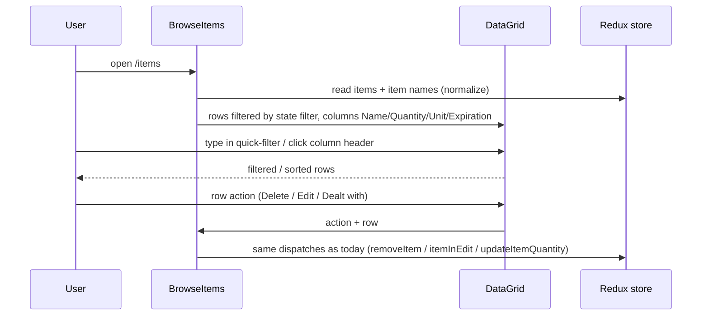

# Modernization Phase 2: Upgrade UI Libraries (Material-UI v4 → MUI v7) Plan

**Plan Status**: `FINAL`

**Story Type**: `Internal`

> This plan captures **what** to build and **why** — domain, architecture, decisions, and verified facts.
> It deliberately does **not** contain implementation code, pseudocode, line numbers, mock setups, or test bodies.
> The implementation agent discovers the **how** against live code. See §4 Task Breakdown.

Source: GitHub issue [#27](https://github.com/bcichonski/BcExpiGuard/issues/27). This is the third phase of the modernization plan (`doc/modernization-plan.md`). It builds on Phase 1 ([#26](https://github.com/bcichonski/BcExpiGuard/issues/26), merged in PR #41), which provides the Vite 8 build, Vitest (9 files / 127 tests), ESLint 9 flat config and CI. It blocks Phase 3 ([#28](https://github.com/bcichonski/BcExpiGuard/issues/28), React 18+ / React Router / Auth0 React SDK / RTK 2).

---

## 1. Problem Statement

*   **Context**: `react-ui/` runs on React 16.13 with Material-UI v4 (`@material-ui/core`, `icons`, `lab`, `pickers`, `styles`), JSS styling (`makeStyles`/`withStyles`), the abandoned `material-table` on the Browse page, `recharts` 1, `react-responsive` for the app-level mobile flag, and an unused `typeface-roboto` dependency. MUI v4 and `material-table` don't support React 18, which blocks Phase 3. `material-table` also accounts for most of the remaining `npm audit` findings (`jspdf`/`dompurify`). Phase 1 had to add a `resolve.dedupe` workaround for its nested pickers copy.
*   **Goal**: After this phase there are no `@material-ui/*`, `material-table`, `@date-io/*`, `react-responsive` or `typeface-roboto` imports or dependencies left. The UI runs on MUI v7 (Emotion) with MUI X v8 pickers and data grid, and on `recharts` 3. Every page looks and behaves the same as before at desktop and mobile widths, apart from the documented deltas in §3.
*   **In scope**: issue tasks 2.1–2.7, plus the minimal React 16 → 17 bump that MUI v5+ requires (see §2.2 Source Conflict Log).
*   **Out of scope**:
    *   React 18/19, `createRoot`, StrictMode, React Router, Auth0 SDK, Redux Toolkit 2, `date-fns` 4 (all Phase 3).
    *   Redesigning any page or fixing defects pinned by the Phase 0 characterization tests.
    *   `server/` changes.

### 1.1 Technical Summary

*   **Touched projects**: `react-ui` only: `package.json`/lockfile, `vite.config.mjs`, `src/index.jsx`, `src/App.jsx`, every component under `src/components`, `src/containers`, `src/pages`, `src/constants/appBarItems.jsx`, plus new/updated tests under `src/tests`.
*   **New patterns / abstractions**: one app theme module (`createTheme` holding the v4 look: palette, `standard` input variant) applied by a `ThemeProvider` + `CssBaseline` at the root. Styling uses `styled()` / `sx` instead of JSS hooks. A `LocalizationProvider` with the date-fns adapter replaces `MuiPickersUtilsProvider`.
*   **Infrastructure changes**: None. The build output, server, service worker and CI are unchanged.
*   **End-state observable behavior**: every route (`/welcome`, `/`, `/items`, `/item/add`, `/item/edit`, `/profile`) renders on MUI v7 and looks like the before screenshots. The Browse table keeps the state filter (Active / Done / Deleted / None), text search, column sorting, row hover and the per-row Delete / Edit / Dealt-with actions (inline icons on desktop, a ⋮ menu on mobile). The Add/Edit date picker keeps the `yyyy-MM-dd` format and a minimum date of today. Build, tests and lint all stay green.

---

## 2. Architecture & Design

### 2.1 Architecture Overview

#### Involved services & owners

| Service | Technical Owner |
| :--- | :--- |
| `react-ui` (frontend) | repo owner (@bcichonski) |

#### C2 diagram

```mermaid
flowchart LR
    Index[src/index.jsx] --> Font[@fontsource/roboto]
    Index --> App[App.jsx]
    App --> Theme[ThemeProvider + CssBaseline<br/>app theme: v4 palette, standard variant]
    Theme --> Loc[LocalizationProvider<br/>AdapterDateFns for date-fns 2]
    Loc --> Layout[containers/Layout + NavBar + Drawer]
    Layout --> Pages[pages: MainContent, AddItem, BrowseItems, Profile, LandingPage]
    Pages --> MUI[@mui/material v7 + @mui/icons-material v7<br/>styled / sx on Emotion]
    Pages --> Grid[@mui/x-data-grid v8 MIT<br/>BrowseItems]
    Pages --> Pickers[@mui/x-date-pickers v8<br/>components/DatePicker]
    Pages --> Charts[recharts 3<br/>components/Chart]
```

#### Flow diagram



### 2.2 External Contracts & Evidence

`N/A — Internal story.` No external API is called. The library facts below were verified from the npm registry (`npm view <pkg>@<range> peerDependencies`, 2026-10-16) and drive the decisions in §3:

| Package (version line) | Peer requirement that matters |
| :--- | :--- |
| `@mui/material` 5.x / 7.3.x / 9.x | `react ^17 \|\| ^18 \|\| ^19`. No line supports React 16. |
| `@mui/x-data-grid` 8.29.x, `@mui/x-date-pickers` 8.x | `react ^17 \|\| ^18 \|\| ^19`, `@mui/material ^5.15.14 \|\| ^6 \|\| ^7` |
| `@mui/x-*` 9.x | `@mui/material ^7.3 \|\| ^9` |
| `material-react-table` 2.x / 3.x | `react >=18` (only early 2.x pre-releases allowed `>=17`, with MUI v5) |
| `recharts` 3.10 | `react ^16.8 \|\| … \|\| ^19`, `react-is` same range |
| `tss-react` 4.9 | supports MUI 5–9 (not used, see §3) |

#### Source Conflict Log

| Topic | Source A | Source B | Conflict | Chosen Handling |
| :--- | :--- | :--- | :--- | :--- |
| React version | Issue #27: UI libs only; #28 owns "React 16 → 18" | npm peers: every MUI v5+ line needs React ≥17 | Phase 2 can't be done on React 16 | Bump React/ReactDOM to **17.0.2** in this phase (T1), the smallest step that unblocks MUI. React 18/19, `createRoot` and StrictMode stay in Phase 3. |
| Table component (issue's open decision) | `material-react-table`: closest to the `material-table` API | MRT 2/3 need React ≥18; MUI X DataGrid MIT supports React 17 | MRT would drag the Phase 3 React 18 upgrade into this phase | **MUI X `DataGrid` (MIT, v8)**. See §3. |
| Target MUI major | Issue: "v5+, then on to v6/v7" | Latest is 9.x; MUI X 8 supports material ≤7, MUI X 9 needs ≥7.3 | v9 isn't named in the issue | **MUI v7.3.x + MUI X v8**. This is the newest pair the issue names. A v9 bump is a later, small step. |
| `typeface-roboto` | Issue 2.7: replace with `@fontsource/roboto` | Code: the package is in `package.json` but imported nowhere | Roboto isn't actually loaded today | Import `@fontsource/roboto` (300/400/500/700) once in `index.jsx`, as MUI documents. Text now renders in Roboto instead of the fallback sans-serif. This is a deliberate, tiny visual delta, recorded in the PR. |
| Media query in `App.jsx` | Issue 2.7: `react-responsive` → MUI `useMediaQuery` | Code: `{ maxDeviceWidth: 1000 }` (device width, not viewport) | MUI's `useMediaQuery` takes a raw query string | Use MUI `useMediaQuery` with the equivalent raw query `(max-device-width:1000px)`, so the `isMobile` semantics stay identical. |

### 2.3 Affected Areas

| Area / File (pointer) | Role in this change | Likely action |
| :--- | :--- | :--- |
| `react-ui/package.json`, `package-lock.json` | Dependency set | Change |
| `react-ui/vite.config.mjs` | `resolve.dedupe: ['@material-ui/pickers']` exists only for material-table; test `server.deps.inline` may need MUI X entries | Change |
| `react-ui/src/index.jsx` | Root render, place for the font import | Change |
| `react-ui/src/App.jsx` | `react-responsive`, `MuiPickersUtilsProvider`; natural home for ThemeProvider / LocalizationProvider | Change |
| new `react-ui/src/theme.js` (or similar) | App theme preserving the v4 look | New |
| `react-ui/src/containers/Layout.jsx` | JSS (`makeStyles` with prop-driven drawer width, `theme.mixins.toolbar`), Drawer, Snackbar, `@material-ui/lab/Alert` | Change |
| `react-ui/src/components/NavBar.jsx` | `makeStyles` + `withStyles` (StyledMenu / StyledMenuItem), AppBar shift transitions | Change |
| `react-ui/src/components/{LoadingPanel,Deposits,ExpireSoonList,ChoiceDialog}.jsx`, `src/pages/{MainContent,AddItem}.jsx` | Remaining JSS users (ChoiceDialog only has commented-out JSS) | Change |
| `react-ui/src/components/{SyncState,Title,Copyright,ConfirmDialog,InputDialog,DealtWithDialog}.jsx`, `src/constants/appBarItems.jsx`, `src/pages/{Profile,LandingPage}.jsx` | Plain MUI/icons imports | Change (imports) |
| `react-ui/src/components/DatePicker.jsx` | `@material-ui/pickers` `DatePicker` (mobile dialog) / `KeyboardDatePicker` (desktop inline) | Change |
| `react-ui/src/components/Autocomplete.jsx` | `@material-ui/lab` Autocomplete; `renderOption` signature changes in v5+ | Change |
| `react-ui/src/pages/BrowseItems.jsx` | `material-table` with custom toolbar, row actions, per-cell styles | Change (rewrite of the table part) |
| `react-ui/src/components/Chart.jsx` | `recharts` 1 line chart (dashboard demo data) | Change |
| `react-ui/src/logic/item-edit-add/actions.js` | Consumes the picker's `Date` and formats it to `yyyy-MM-dd`; the contract the new picker must keep | Reference |
| `react-ui/src/tests/App.test.jsx` | Smoke test; must stay green | Reference / Change |

### 2.4 Key Algorithms & Behaviour

*   **Look-and-feel preservation**. MUI v5+ changed several defaults, and this phase overrides them back to v4 behaviour:
    *   Palette: v4 primary indigo `#3f51b5`, secondary pink `#f50057`. v5+ defaults to blue/purple.
    *   Input variant: v4 TextField/Select/FormControl defaulted to `standard`. v5+ defaults to `outlined`. Restore it through theme `defaultProps`, not per call site.
    *   Breakpoints: v4 `breakpoints.down('sm')` meant `< 960px`. In v5+ it means `< 600px`. Every `down('sm')` (BrowseItems, AddItem, ExpireSoonList) becomes `down('md')` so the same widths count as mobile. `up(...)` and `between(...)` are unchanged.
    *   Grid: v7 `Grid` uses `size`/`container` and drops `item` and `justify` (now `justifyContent`). Port to the v7 Grid, not `GridLegacy`. Global selectors on `.MuiGrid-root` / `.MuiTableRow-root` in JSS move with the styles that use them.
*   **JSS → Emotion**. `makeStyles` hooks that read props (Layout's drawer width depends on `isMobile`) become `styled()` components with props or `sx` callbacks. `withStyles` wrappers (NavBar menu) become `styled()`. Class composition with `clsx` either goes away or applies to `className` on styled components. No `@mui/styles` and no `tss-react`.
*   **DatePicker contract**. The store holds `date` as a `yyyy-MM-dd` string. MUI X v8 with the date-fns adapter needs a `Date` value, so the component parses the string with `DATE_FORMAT` (empty → `null`) on the way in. On the way out it passes what the picker emits (`Date`, `null`, or an invalid `Date` while typing) to `setDate`, exactly as v4 did, so `itemExpirationDateChanged` validation keeps its current behaviour. `isMobile` → `MobileDatePicker` (dialog, no toolbar, closes on select), otherwise `DesktopDatePicker` (typed input + popper, closes on select). Use the explicit variants, not the responsive `DatePicker`, because the app makes its own mobile decision. The format is `yyyy-MM-dd`, `minDate` is today, and `error` + `helperText` reach the field via `slotProps.textField`. Use the adapter export that targets **date-fns 2** (v8 names it `AdapterDateFnsV2`; check the installed package).
*   **Autocomplete contract**. The free-solo input value is controlled by `props.value`. The existing `reset` handling (don't wipe a typed value on reset) stays. `renderOption` moves to the v5+ signature `(props, option, state)`: the `li` props are spread and the highlight rendering is unchanged.
*   **Browse table (DataGrid MIT)**:
    *   Rows: the existing `normalize` + state-filter pipeline is unchanged. Row id = item `id`.
    *   Columns: Name, Quantity (`Qt.` on mobile), Unit, Expiration date (`Exp.` on mobile), plus an actions column. Desktop shows three inline icon actions (Delete / Edit / Dealt with, same icons and tooltips). Mobile shows one ⋮ action that opens the existing `Menu`. The dialogs (`ConfirmDialog`, `DealtWithDialog`) and dispatches are unchanged.
    *   Toolbar: the state `Select` (Active / Done / Deleted / None, default Active) sits next to the grid's quick-filter search box, matching today's Filter-select + search layout. Column sorting stays on. Column menus, density, export, selection checkboxes and row-click selection are off unless they already existed. Row hover highlight stays (DataGrid has it natively).
    *   Paging: material-table showed every row unpaged. The DataGrid MIT licence caps the page size at 100, so set page size 100 with options 25/50/100. A user with up to 100 matching items still sees one page.
    *   Mobile compactness: compact density or reduced cell padding, matching today's tighter mobile cells.

---

## 3. Key Decisions & Assumptions

*   **Decision — React 17.0.2 in this phase.** Required by every MUI v5+ peer range (§2.2). React 17 has no new root API and no StrictMode changes for this app. `ReactDOM.render` keeps working, so Phase 3 keeps its scope. `@testing-library/react` moves to the 12.x line (React 17's line) if v9 doesn't work under React 17. `react-redux` 7, `@reach/router` 1.3 and `spinners-react` 1 already accept React 17.
*   **Decision — MUI v7.3.x + `@mui/icons-material` v7 + Emotion (`@emotion/react`, `@emotion/styled`); MUI X v8 (`@mui/x-date-pickers`, `@mui/x-data-grid`, MIT).** This is the newest combination within the issue's "v5+ → v6/v7" that MUI X supports. The migration is done directly to v7: run the `@mui/codemod` v5 `preset-safe` as a starting point, then hand-fix to the v7 APIs. The intermediate v5/v6 states aren't committed. Each task leaves build + tests green.
*   **Decision — Table: MUI X `DataGrid` (MIT)**, resolving the issue's open decision. It is first-party, supports React 17, and the features this page uses (sorting, quick filter, action column, hover) are all in the MIT tier. `material-react-table` 2/3 need React ≥18, which would pull Phase 3 into this phase.
*   **Decision — No `tss-react`, no `@mui/styles`.** The issue allows `tss-react` for a mechanical port, but the JSS surface is 9 small files. Porting them to `styled`/`sx` once avoids adding a dependency that a later phase would remove again.
*   **Decision — Preserve the v4 look through the theme** (palette, `standard` variant) and breakpoint mapping (`down('sm')` → `down('md')`), per §2.4.
*   **Decision — MUI v4 coexists temporarily.** Until T5 removes `material-table`, `@material-ui/core` v4 stays installed for it, and v4 and v7 run side by side. T6 removes every v4 package, the `resolve.dedupe` workaround, and any now-unneeded `overrides`.
*   **Assumption — paging delta on Browse is acceptable.** More than 100 items matching one filter now paginate. The MIT licence makes this unavoidable, the issue accepted DataGrid knowing some features are paid, and it is a minor, visible, reversible UX delta. Called out in the PR. Low stakes, so not an open question.
*   **Assumption — Roboto now actually loads** (`typeface-roboto` was never imported). Called out in the PR as an intended small visual delta.
*   **Assumption — visual check without Auth0.** Restricted pages need an Auth0 login, and the real tenant is not ours to use from the sandbox. Before/after screenshots of restricted pages are taken through an **uncommitted** local harness. For example, a scratch entry or a Vite alias that stubs `common/auth0` as authenticated and stubs `persistence` with fixture items, served by `vite`/`vite preview`. `/welcome` can also be shot through the real build. "Before" shots come from the current master code (T1, before any library change), "after" shots from the final code (T6), at 1280×800 (desktop) and 390×844 (mobile). Store them outside the repo (scratchpad) and summarize deltas in the PR. The harness is not committed.

### 3.1 Decision Lock (Constants & Policies)

| Constant / Policy | Selected Value | Why | Where it lives |
| :--- | :--- | :--- | :--- |
| React / ReactDOM | `17.0.2` | Minimal version accepted by MUI v5+ | `package.json` |
| MUI core | `@mui/material` / `@mui/icons-material` `^7.3` | Newest major named by the issue that is supported by MUI X 8 | `package.json` |
| MUI X | `@mui/x-date-pickers` / `@mui/x-data-grid` `^8` (MIT) | Supports material 7 + React 17 | `package.json` |
| Charts | `recharts` `^3` | Issue 2.6, React 16.8+ compatible | `package.json` |
| Font | `@fontsource/roboto` weights 300/400/500/700 | MUI docs | `src/index.jsx` |
| Palette | primary `#3f51b5`, secondary `#f50057` | v4 defaults the app was designed on | theme module |
| Input variant | `standard` for TextField / Select / FormControl | v4 default | theme `defaultProps` |
| Mobile breakpoint mapping | v4 `down('sm')` → v7 `down('md')` | Same `< 960px` threshold | components |
| App `isMobile` | MUI `useMediaQuery('(max-device-width:1000px)')` | Identical to the `react-responsive` query | `App.jsx` |
| Date format / min date | `yyyy-MM-dd` / today | Unchanged | `DatePicker.jsx` |
| Browse page size | 100, options 25/50/100 | MIT cap | `BrowseItems.jsx` |
| Browse default filter | `ITEM_ACTIVE` | Unchanged | `BrowseItems.jsx` |
| Screenshot viewports | 1280×800, 390×844 | Desktop + mobile | verification only |

### 3.2 Open Questions

No open questions. The issue's only open decision (the table component) is closed in §3 from npm peer ranges (React ≥18 for MRT vs ≥17 for DataGrid). The React 17 prerequisite is closed from peer ranges plus issue #28's scope.

---

## 4. Task Breakdown

All tasks edit `react-ui/package.json` and the lockfile, so they run strictly in sequence.

| Task | Title | Depends on | Complexity |
| :--- | :--- | :--- | :--- |
| `T1` | Baseline screenshots + React 17 | — | `Medium` |
| `T2` | MUI v7 foundation: theme, font, app shell off JSS | `T1` | `High` |
| `T3` | Dashboard, Autocomplete and remaining components on MUI v7 | `T2` | `Medium` |
| `T4` | Date picker → MUI X v8 and Add/Edit page | `T3` | `Medium` |
| `T5` | Browse page: material-table → MUI X DataGrid | `T4` | `High` |
| `T6` | recharts 3, remove v4 packages, exit-criteria sweep and after screenshots | `T5` | `Medium` |

### T1 — Baseline screenshots + React 17

*   **Goal**: The before-screenshots exist, and the app runs on React 17.0.2 with no other behaviour change.
*   **Depends on**: `—`
*   **Complexity**: `Medium`
*   **Pointers**: `react-ui/package.json`, `src/tests/App.test.jsx`, `src/setupTests.js`, `src/common/auth0.jsx`, `src/persistence/index.js`, `vite.config.mjs`; see the §3 visual-check assumption.
*   **Definition of Done**:
    *   **Before any dependency change**, build an uncommitted screenshot harness. It stubs Auth0 as authenticated and persistence with a handful of fixture items covering all states and both mobile/desktop label variants. Capture `/welcome`, `/`, `/items` (Active filter and None filter), `/item/add` (with the date picker open), `/profile` and the open nav drawer at 1280×800 and 390×844 into the scratchpad. Record the harness approach in the task notes so T6 can reuse it.
    *   `react` / `react-dom` at 17.0.2; testing-library upgraded only if needed; `npm ci` from the lockfile works without `--legacy-peer-deps` apart from conflicts caused by MUI v4/material-table, which are expected until T6. If a v4 package rejects React 17, document the minimal `overrides` entry used.
    *   `npm run build`, `npm test` (all existing tests) and `npm run lint` (0 errors) pass. The app boots in Chromium with no new console errors.
*   **Tests expected**: existing suite green; no new tests (version bump only).

### T2 — MUI v7 foundation: theme, font, app shell off JSS

*   **Goal**: MUI v7 + Emotion are installed, the root has the v4-look theme, Roboto loads, and the app shell (layout, nav bar, drawer, menus, snackbar alert, loading panel) uses `@mui/material` / `@mui/icons-material` with no JSS.
*   **Depends on**: `T1`
*   **Complexity**: `High`. The cross-cutting styling migration sets the pattern every later task follows, and look-and-feel regressions here show on every page.
*   **Pointers**: `src/index.jsx`, `src/App.jsx`, new theme module, `src/containers/Layout.jsx`, `src/components/NavBar.jsx`, `src/components/LoadingPanel.jsx`, `src/components/SyncState.jsx`, `src/components/Title.jsx`, `src/components/Copyright.jsx`, `src/constants/appBarItems.jsx`, `src/pages/Profile.jsx`, `src/pages/LandingPage.jsx`; §2.4 look-and-feel rules.
*   **Definition of Done**:
    *   `@mui/material`, `@mui/icons-material` (^7.3), `@emotion/react`, `@emotion/styled` and `@fontsource/roboto` are installed. The theme module (palette + `standard` variant defaults) is applied via `ThemeProvider` + `CssBaseline` at the app root, above the existing pickers provider, which stays until T4. Font weights are imported once in `index.jsx`.
    *   The listed files import nothing from `@material-ui/*`. `@material-ui/lab/Alert` becomes `@mui/material/Alert`. Their `makeStyles`/`withStyles` are replaced with `styled`/`sx`, including the prop-driven drawer widths and AppBar shift transitions.
    *   Drawer open/close, the nav menu and the snackbar look and behave as in the T1 screenshots at both viewports.
    *   Build, tests and lint (0 errors) pass. No new console errors or React warnings at boot.
*   **Tests expected**: the App smoke test stays green under the new providers. Add one component-level test that renders the Layout/NavBar shell inside the theme and checks that the drawer toggle opens and closes the drawer.

### T3 — Dashboard, Autocomplete and remaining components on MUI v7

*   **Goal**: The dashboard and every remaining non-picker, non-table component use MUI v7 with no JSS. Autocomplete comes from `@mui/material`. `react-responsive` is gone.
*   **Depends on**: `T2`
*   **Complexity**: `Medium`
*   **Pointers**: `src/pages/MainContent.jsx`, `src/components/{ExpireSoonList,Deposits,ChoiceDialog,ConfirmDialog,InputDialog,DealtWithDialog,Autocomplete}.jsx`, `src/App.jsx` (media query); §2.4 Autocomplete contract and breakpoint mapping; §3.1 `isMobile` query.
*   **Definition of Done**:
    *   Those files import nothing from `@material-ui/*` and have no `makeStyles`/`withStyles`. ChoiceDialog's commented-out JSS is removed or ported.
    *   `components/Autocomplete` uses `@mui/material` Autocomplete with the v5+ `renderOption` signature. Highlighting, grouping, free-solo typing and the reset-preserves-value behaviour are unchanged.
    *   `App.jsx` computes `isMobile` with MUI `useMediaQuery('(max-device-width:1000px)')`, and `react-responsive` is uninstalled.
    *   The dashboard (expire-soon list with strikethrough for done items, FAB) and the dialogs match the T1 screenshots.
    *   Build, tests and lint (0 errors) pass.
*   **Tests expected**: component tests (RTL) for Autocomplete: typed free-solo text propagates via `setValue`; the reset event doesn't wipe a non-empty value; options render with the matched part highlighted. ExpireSoonList: done items render struck through, and the mobile vs desktop column labels are correct.

### T4 — Date picker → MUI X v8 and Add/Edit page

*   **Goal**: `components/DatePicker` uses `@mui/x-date-pickers` v8 with the date-fns 2 adapter. The Add/Edit page is on MUI v7 with no JSS. `@material-ui/pickers` and `@date-io/date-fns` are no longer used by app code.
*   **Depends on**: `T3`
*   **Complexity**: `Medium`
*   **Pointers**: `src/components/DatePicker.jsx`, `src/pages/AddItem.jsx`, `src/App.jsx` (provider swap), `src/logic/item-edit-add/actions.js` (value contract), `src/constants/constants.js` (`DATE_FORMAT`); §2.4 DatePicker contract.
*   **Definition of Done**:
    *   `LocalizationProvider` with the date-fns-2 adapter replaces `MuiPickersUtilsProvider`. The mobile and desktop variants follow §2.4. Format is `yyyy-MM-dd`, min date today, and the error state and helper text show.
    *   The store string goes in as a parsed `Date` (empty → no value) and the picker output reaches `setDate` unchanged. Adding and editing an item stores the same `yyyy-MM-dd` string as before, and an invalid or empty date still produces "Pick a valid date".
    *   `AddItem.jsx` imports nothing from `@material-ui/*` and has no JSS. `justify` → `justifyContent`, breakpoint mapped.
    *   App code no longer imports `@material-ui/pickers` / `@date-io/date-fns`. They can only remain installed as material-table's dependencies until T6.
    *   Build, tests and lint (0 errors) pass.
*   **Tests expected**: DatePicker component tests: a `yyyy-MM-dd` string renders as that text; picking or typing a date calls `setDate` with a `Date` that formats back to the same string; dates before today are disabled or rejected. The error prop shows the helper text. The existing `item-edit-add` logic tests stay green.

### T5 — Browse page: material-table → MUI X DataGrid

*   **Goal**: `/items` uses `@mui/x-data-grid` v8 (MIT) and keeps every behaviour listed in §2.4. `material-table` is removed.
*   **Depends on**: `T4`
*   **Complexity**: `High`. A full rewrite of the most interactive page with responsive actions and a custom toolbar.
*   **Pointers**: `src/pages/BrowseItems.jsx`, `src/components/{ConfirmDialog,DealtWithDialog}.jsx`, `src/logic/item-list` (`itemTypes`, actions), `vite.config.mjs` (`resolve.dedupe` comment); §2.4 Browse table rules, §3.1 page size.
*   **Definition of Done**:
    *   The DataGrid shows Name / Quantity / Unit / Expiration date with the mobile short labels. Columns sort. A quick-filter search box and the state `Select` (default Active) sit in a custom toolbar. Rows highlight on hover. The page size is 100, with options 25/50/100.
    *   On desktop each row has Delete / Edit / Dealt-with icon actions with tooltips. On mobile it has a single ⋮ action opening the existing menu. Each action opens the same dialog or dispatches the same action as today, for the right row.
    *   `material-table`, the `forwardRef` icon map and the JSS block are gone. `material-table` is uninstalled. `npm ls` shows no `jspdf`.
    *   Matches the T1 `/items` screenshots in layout and density at both viewports, within the documented deltas (pagination footer).
    *   Build, tests and lint (0 errors) pass.
*   **Tests expected**: BrowseItems component tests with a real store or a mocked connect: the default filter shows only active items; switching to Done / Deleted / None changes the rows; the quick filter narrows by name; desktop shows the three actions and mobile shows the menu. Delete → confirm dispatches `removeItem` with the row id. Edit dispatches `itemInEdit` with the row. If jsdom needs it, disable virtualization in tests.

### T6 — recharts 3, remove v4 packages, exit-criteria sweep and after screenshots

*   **Goal**: The exit criteria hold: no `@material-ui/*` / `material-table` imports or packages remain, `recharts` is on v3, the workarounds that only existed for v4 are gone, and the visual check is done.
*   **Depends on**: `T5`
*   **Complexity**: `Medium`
*   **Pointers**: `src/components/Chart.jsx`, `react-ui/package.json` (`@material-ui/*`, `@date-io/date-fns`, `typeface-roboto`, `overrides`), `vite.config.mjs` (`resolve.dedupe`, test inline deps), `README.md` (stack mentions), the T1 harness notes.
*   **Definition of Done**:
    *   `recharts` ^3 and `Chart.jsx` adjusted if its API changed. The chart renders with theme colours.
    *   `@material-ui/core`, `icons`, `lab`, `pickers`, `styles`, `@date-io/date-fns` and `typeface-roboto` are uninstalled. `resolve.dedupe` for pickers is removed. `overrides` is kept only where still needed, with a comment saying why. `npm ci` works without `--legacy-peer-deps`.
    *   `grep -r "@material-ui\|material-table\|react-responsive\|typeface-roboto\|makeStyles\|withStyles" react-ui/src` returns nothing.
    *   After screenshots are taken with the same harness, routes and viewports as T1, and compared. Differences beyond the documented deltas (Roboto font, Browse pagination footer, MUI v7 ripple/elevation minutiae) are fixed or listed with a reason.
    *   `npm audit` (react-ui) is recorded before and after for the PR. README is updated if it names the old UI libraries.
    *   From a clean `npm ci`: root `NODE_ENV=production npm run build`, `npm test`, `npm run lint` (0 errors) pass. The app boots in Chromium with no console errors and the service worker still registers.
*   **Tests expected**: full suite green. Chart smoke-render test (renders inside a sized container without throwing).

---

## 5. Verification

*   **Build**: from a clean `npm ci` in `react-ui`, `npm run build`. At the repo root, `NODE_ENV=production npm run build` (the Heroku path).
*   **Unit/component tests**: `npm test` in `react-ui`: the existing 127 tests plus the new component tests are green.
*   **Lint**: `npm run lint`, 0 errors.
*   **Exit-criteria grep**: no `@material-ui`, `material-table`, `react-responsive`, `typeface-roboto`, `makeStyles` or `withStyles` in `react-ui/src` or in `package.json` dependencies.
*   **Observable behaviour**: before/after screenshots of every route at 1280×800 and 390×844 match within the documented deltas. Browse filter, search, sort and row actions work. The Add/Edit date picker stores `yyyy-MM-dd`. The PWA service worker still registers.

---

## 6. Fact-Integrity Checklist

| Check | Yes / No / N/A | Notes |
| :--- | :--- | :--- |
| External contracts (routes, payload type ids, DTO fields, identifier types) verified from producer/contract source — not story text | N/A | Internal story; library peer ranges verified from the npm registry |
| Evidence sources are reproducible (exact repo file path/symbol) | N/A | Internal; `npm view <pkg> peerDependencies` reproducible |
| Identifier directionality / ordering / freshness **meaning** evidenced separately from field shape, or moved to an Open Question | N/A | Internal |
| Every `Assumption` is linked to an Open Question (§3.2) | Yes | The three assumptions are low-stakes UX/verification calls, recorded and surfaced in the PR; none affects correctness |
| No unresolved Open Questions (for `FINAL`) | Yes | |
| Each Decision states a single committed approach | Yes | |
| Tasks are independent, each with a Definition of Done and test expectations | Yes | Sequential by necessity (shared `package.json`/lockfile) |
| Required infra reflected: toggle-gated where the story carries a toggle key; new Service Bus subscription/queue ⇒ a task updates `infrastructure.bicep` | N/A | No toggle, no infra |

**Self-review note**: The biggest uncertainty is visual fidelity. MUI v7 differs from v4 in defaults (variant, breakpoints, palette, Grid), so the plan pins each one in §3.1, and the agent should check every page against the T1 screenshots rather than trust the codemod. The React 17 bump is a scope addition forced by peer ranges. Keep it minimal. The DatePicker string↔Date boundary and the DataGrid's MIT paging cap are the two behavioural edges to test explicitly.
