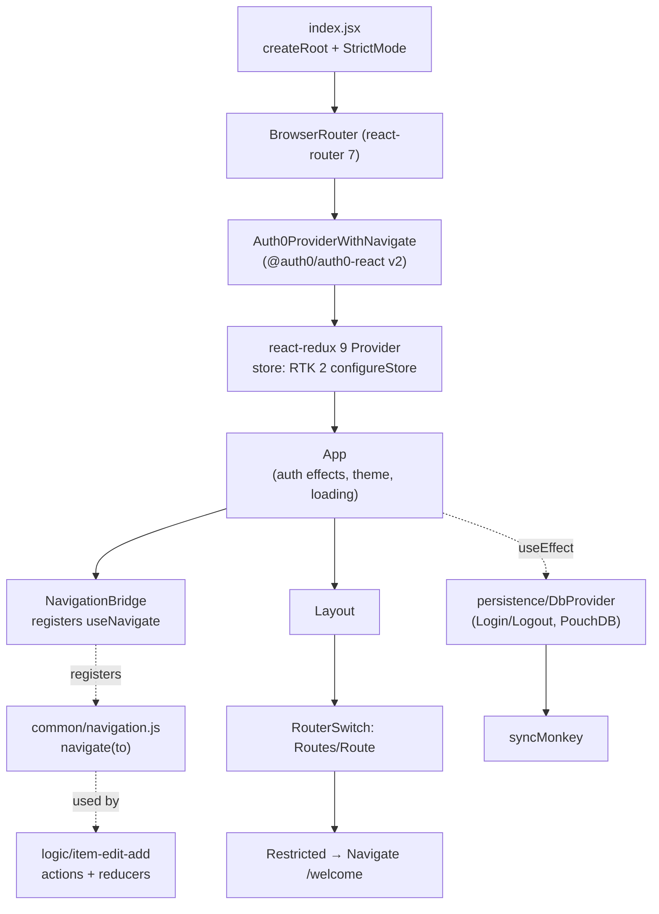
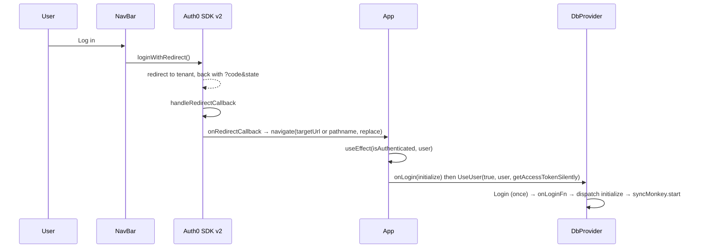

# Modernization Phase 3: React 18+, React Router, Auth0 React SDK, Redux Toolkit 2 Plan

**Plan Status**: `FINAL`

**Story Type**: `Internal`

> This plan captures **what** to build and **why** — domain, architecture, decisions, and verified facts.
> It deliberately does **not** contain implementation code, pseudocode, line numbers, mock setups, or test bodies.
> The implementation agent discovers the **how** against live code. See §4 Task Breakdown.

---

## 1. Problem Statement

*   **Context**: After Phase 2 (#27, PR #43, merged as `af967fb`) `react-ui` runs on React **17.0.2** with MUI v7 / MUI X v8 / recharts 3. The framework layer is still old:
    *   `src/index.jsx` mounts with legacy `ReactDOM.render`, with `<React.StrictMode>` commented out.
    *   Routing is `@reach/router` 1.3.4, which is archived (merged into React Router). It runs on React 17 only through a scoped `overrides` entry in `react-ui/package.json`. `navigate` is a module-level import used from components (`NavBar`, `Layout`) **and from Redux code** (`logic/item-edit-add/actions.js` and `reducers.js`). A custom `history` object built in `index.jsx` is threaded through `App` → `Layout` → `RouterSwitch`.
    *   Auth is a hand-rolled context (`src/common/auth0.jsx`) around `@auth0/auth0-spa-js` 1.8, which is EOL. It is consumed by `App`, `NavBar`, `Restricted`, `Profile` and `LandingPage`, and by the tests through `Auth0Context.Provider`.
    *   Redux: RTK 1.9 with an explicit `redux-thunk` middleware array, `redux` 4, `react-redux` 8.1.3 (pinned for React 17 in Phase 2), plus `redux-devtools-extension`, which is unused in code.
    *   `App.jsx` runs side effects during render: it registers `dbProvider.onLogin`, calls `dbProvider.UseUser(...)` (async login, which starts PouchDB sync through `syncMonkey`), calls `setState`, and schedules `setTimeout`s. This is why StrictMode was disabled.
    *   Test stack: `@testing-library/react` 9.5 (pre-React-18 line). `@testing-library/user-event` 7 is a dependency but no test imports it. 15 test files / 162 tests, run with Vitest 5.
*   **Goal**: The app runs on React 19 under `<React.StrictMode>` with no console warnings. Routing uses React Router v7, auth uses `@auth0/auth0-react` v2, and state uses Redux Toolkit 2 + react-redux 9. All routes (`/`, `/items`, `/item/add`, `/item/edit`, `/profile`, `/welcome`) and login/logout behave as before, against the same Auth0 tenant config.
*   **In scope**: issue tasks 3.1, 3.2, 3.3, 3.4, 3.5 and 3.7, plus the Phase-2 carry-overs: test renderer bump, `@types/react` pins, `@reach/router` override removal, react-redux dedupe with recharts, and the date-fns adapter switch.
*   **Out of scope**: 3.6 (optional `createSlice` conversion, see D6), migrating Browse to `material-react-table` (see D5), MUI 9 / MUI X 9 (not React-gated, "optional follow-up" per the issue), PouchDB upgrade, server changes.

### 1.1 Technical Summary

*   **Touched projects**: `react-ui` only (`package.json`, lockfile, `vite.config.mjs`, `eslint.config.mjs`, `src/**`, `src/tests/**`). README tech list.
*   **New patterns / abstractions**:
    *   A tiny module-level navigation bridge (`src/common/navigation.js`) so non-component code (Redux reducers/thunks) can still navigate under React Router.
    *   Declarative `BrowserRouter` + `Routes`.
    *   `@auth0/auth0-react` `Auth0Provider` mounted inside the router, so its redirect callback can navigate.
    *   Auth-driven side effects move from render into `useEffect`, and are idempotent so StrictMode double-mounting is safe.
*   **Infrastructure changes**: None. Same Auth0 tenant values (`VITE_AUTH0_*`), same CouchDB, same Express SPA fallback (`server/index.js` serves `index.html` for `*`).
*   **End-state observable behaviour**:
    *   Same pages, routes and login/logout flow.
    *   An unauthenticated visit to a restricted route still redirects to `/welcome`.
    *   The Auth0 redirect back from login lands on the original path without `?code=&state=`.
    *   No React/Router/Redux warnings in the console under StrictMode.

---

## 2. Architecture & Design

### 2.1 Architecture Overview

#### Involved services & owners

| Service | Technical Owner |
| :--- | :--- |
| `react-ui` (Vite SPA) | bcichonski |
| Auth0 tenant (external, config unchanged) | bcichonski |

#### C2 diagram

#### Flow diagram

### 2.2 External Contracts & Evidence

`N/A — Internal story`. The Auth0 tenant is an existing integration whose *configuration values* are kept as-is. No new external API is called. The SDK option mapping in §2.4 comes from the `@auth0/auth0-react` v2 / `auth0-spa-js` v2 migration guide and must be checked by the implementing agent against the installed package's type definitions (`node_modules/@auth0/auth0-react/dist/*.d.ts`).

#### Source Conflict Log

| Topic | Source A | Source B | Conflict | Chosen Handling |
| :--- | :--- | :--- | :--- | :--- |
| React target | Issue 3.1: "React 16 → 18 (then 19)" | npm peer ranges (checked 2026-10-16): every runtime dep accepts React 19 | Two-step vs one-step | Go straight to React **19.2.x** (D1). Every dependency's peer range was verified. |
| Router major | Issue: "React Router v7" | npm: react-router 8.4 is latest (needs react ≥19.2.7) | Newer major exists | Use **v7** (`react-router` ^7.18), as the issue says (D2). |
| Starting React | Issue context: "React 16.13" | Repo: React 17.0.2 since Phase 2 | Issue text predates Phase 2 | Repo wins. Start from 17.0.2. |
| Exit criterion "no console warnings" | Issue | Real Auth0 tenant is not reachable/usable from the sandbox | Can't log in for real | Verify with a stubbed Auth0 in tests plus a `vite preview` boot of `/welcome`. Network errors to the tenant are expected and not app warnings (A1). |

### 2.3 Affected Areas

| Area / File (pointer) | Role in this change | Likely action |
| :--- | :--- | :--- |
| `react-ui/package.json`, `package-lock.json` | Dependency versions, the `overrides` block and its `"//overrides"` comment | Change |
| `react-ui/vite.config.mjs` | `react({ jsxRuntime: 'classic' })` with a React 16 comment; Vitest `server.deps.inline` comment mentions React 17 | Change |
| `react-ui/eslint.config.mjs` | `settings.react.version: '16.13'`, classic-runtime comment | Change |
| `src/index.jsx` | `ReactDOM.render`, commented StrictMode, custom `history`, `Auth0Provider` props | Change |
| `src/App.jsx` | Render-time side effects, `useAuth0` from local context, `history` prop, date-fns V2 adapter import | Change |
| `src/common/auth0.jsx` | Hand-rolled Auth0 context | Delete |
| `src/common/navigation.js` | Module-level navigate bridge for non-component code | New |
| `src/components/RouterSwitch.jsx`, `Restricted.jsx` | Reach `Router` / `Redirect` | Change |
| `src/components/NavBar.jsx`, `src/containers/Layout.jsx` | Reach `navigate`, `useAuth0`, `history` prop | Change |
| `src/logic/item-edit-add/actions.js`, `reducers.js` | Reach `navigate` called from Redux code | Change (import only) |
| `src/pages/Profile.jsx`, `LandingPage.jsx` | `useAuth0` consumers (`loading` → `isLoading`) | Change |
| `src/persistence/DbProvider.js` | `useUserAsync` / `Login` not safe against concurrent calls (StrictMode double effects) | Change |
| `src/common/syncMonkey.js` | Singleton started from the `initialize` thunk; `start()` already restarts | Reference / small change |
| `src/common/store.js`, `src/common/reducers.js` | RTK 2 `configureStore` (middleware must be a callback), `combineReducers` | Change |
| `src/logic/*/reducers.js` | May mutate state (e.g. `appstate` pushes into a shallow-copied `errors` array), which RTK's dev immutability check will flag | Change where flagged |
| `src/components/DatePicker.jsx`, `Autocomplete.jsx` | Function components with `defaultProps`. **React 19 ignores these.** | Change |
| `src/common/utils.js` | `uuid` v5 (namespaced, deterministic user/name ids) and v4; date-fns | Change (version) |
| `src/pages/MainContent.jsx`, `logic/item-list/actions.js`, `logic/item-edit-add/actions.js` | date-fns consumers | Reference / verify |
| `src/components/LoadingPanel.jsx` | `spinners-react` | Reference |
| `src/tests/**` (15 files), `src/setupTests.js` | RTL 9 → 16. Tests inject `Auth0Context.Provider` and `history={{}}`. `item-edit-add.test.js` mocks `@reach/router` | Change |
| `README.md` | Tech list | Change |

### 2.4 Key Algorithms & Behaviour

*   **Mounting**: `createRoot(...).render(...)` wrapped in `<React.StrictMode>`. `registerSW` stays as is.
*   **Provider order** (outer → inner): `StrictMode` → `BrowserRouter` → Auth0 provider wrapper → react-redux `Provider` → `App`.
    *   The Auth0 wrapper sits inside the router because its `onRedirectCallback` uses `useNavigate`.
    *   `onRedirectCallback` navigates to `appState.targetUrl` if present, else `window.location.pathname`, with `replace: true`. This keeps the v1 target rule, and the `?code&state` entry doesn't stay in history.
*   **Auth0 option mapping (v1 → v2)**, values unchanged:
    *   `domain` → `domain`
    *   `client_id` → `clientId`
    *   `redirect_uri` → `authorizationParams.redirect_uri` (`window.location.origin`)
    *   `audience` → `authorizationParams.audience`
    *   Consumers:
        *   `loading` → `isLoading`
        *   `getTokenSilently` → `getAccessTokenSilently`
        *   `logout()` stays argument-less, so Auth0 applies the tenant's default logout return URL exactly as v1 did (D4)
        *   `loginWithRedirect()` no-arg
    *   Cache location and refresh-token settings stay at the SDK defaults (memory, no refresh tokens), the same as v1.
*   **Navigation bridge**: `common/navigation.js` holds the current navigate function and exposes `navigate(to, options)`.
    *   A `NavigationBridge` component inside the router registers `useNavigate()` in an effect and clears it on cleanup.
    *   Calls made before registration are ignored with a dev `console.warn`. Redux only navigates after user actions, by which point the router is mounted.
    *   Redux code (`item-edit-add` actions/reducers) imports `navigate` from this module instead of `@reach/router`.
    *   The reducer side effect itself is pre-existing and documented as an "ODDITY" test. It is **not** redesigned here.
*   **Routes**: `/`, `/items`, `/item/add`, `/item/edit` and `/profile` render through `Restricted`. When not authenticated, `Restricted` renders `<Navigate to="/welcome" replace />`. `/welcome` is public. Unknown paths keep current behaviour: reach rendered nothing for an unmatched path, so no catch-all route is added.
*   **Auth-driven effects (StrictMode-safe)**: one `useEffect` in `App`, keyed on `isAuthenticated` and `user`, does the following in order:
    1.  Registers `dbProvider.onLogin(...)` (dispatches `initialize`).
    2.  Calls `dbProvider.UseUser(isAuthenticated, user, getAccessTokenSilently)`.
    *   `DbProvider` must make login idempotent under concurrent invocation. A second call while the first is awaiting the token must not run `Login` twice (no double PouchDB/remote setup, no double `initialize`). Logout remains safe to call repeatedly.
    *   The `appInitialization` state flip is no longer done during render.
    *   The two loading timers (`useMoreElves` after 5 s, `ignoreLoading` after 10 s) become an effect with cleanup that runs while `isLoading` is true.
    *   `syncMonkey.start()` already stops first, so a double start leaves one timer.
*   **Redux store**:
    *   `configureStore` with `middleware` as a callback over `getDefaultMiddleware()`, which includes thunk.
    *   Dev immutability/serializability checks stay **on**. Any reducer mutation they flag is fixed (copy instead of mutate) without changing the resulting state shape.
    *   If a check flags a value that is non-serializable by design, ignore only that action type or path.
    *   `devTools: !import.meta.env.PROD` stays.
    *   `redux-thunk`, `redux-devtools-extension` and the direct `redux` dependency are removed; `combineReducers` comes from RTK.
    *   Only one `react-redux` (9.x) is installed, shared with recharts.
*   **IDs must not change**: `createUUID` (uuid v5 with fixed namespaces) derives the user id, and with it the local PouchDB names `items_<id>` and the remote filter params. Any `uuid` upgrade must produce byte-identical v5 outputs. A test pins a known input → output pair computed on the current version before the bump.
*   **Dates**: date-fns 4 keeps the same named functions used here. The MUI X adapter import moves from `AdapterDateFnsV2` to the default `AdapterDateFns` (date-fns 3/4) in `App.jsx` and the DatePicker test. The `yyyy-MM-dd` format and the stored string format stay the same.

---

## 3. Key Decisions & Assumptions

*   **D1 — React 19.2.x directly** (`react`, `react-dom`, `react-is` at the same 19.2.x).
    *   The issue allows 18 then 19, and peer ranges verified on npm 2026-10-16 all accept 19:
        *   `@auth0/auth0-react` 2.28 (`^19.2.1`)
        *   react-router 7 (`>=18`)
        *   react-redux 9, `@reduxjs/toolkit` 2
        *   `@testing-library/react` 16
        *   MUI 7.3, MUI X 8.29
        *   recharts 3.10, spinners-react 1.0.11
    *   One upgrade instead of two.
*   **D2 — React Router v7** (`react-router` ^7.18, using its `BrowserRouter`/`Routes`/`Navigate`/`useNavigate` exports). It is declarative mode, not data-router mode: a smaller structural change, and `Layout`/`RouterSwitch` keep their shape. v8 is out of scope because the issue names v7.
*   **D3 — Module-level navigation bridge** (§2.4) instead of rewriting reducer side effects. The reducer→navigate oddity is pre-existing and tested, and redesigning it is outside this phase.
*   **D4 — Auth0 behaviour parity**: same env values, `redirect_uri` = origin, `audience` from env, logout without `returnTo` (as today), default cache/refresh settings.
*   **D5 — Browse table: keep MUI X DataGrid** (the issue's open decision).
    *   Phase 2 already delivered and tested it, and `src/tests/BrowseItems.test.jsx` covers it.
    *   Switching to MRT 3 would add a second table stack and restyle `/items` inside a framework-upgrade phase, which is a UX change.
    *   The 100-rows-per-page cap is acceptable for a personal item list.
    *   Possible follow-up: MRT 3 now that React 19 is in place.
*   **D6 — Skip 3.6 (`createSlice` conversion)**. The issue marks it optional. It would rewrite every reducer and action-type contract the tests pin down, and the store works unchanged under RTK 2.
*   **D7 — Test stack**:
    *   `@testing-library/react` 16 + `@testing-library/dom` 10, moved to `devDependencies`.
    *   Remove the unused `@testing-library/user-event`.
    *   `@types/react` / `@types/react-dom` pins go away; no TypeScript in the repo needs them, and React 19 peers resolve them.
    *   Switch Vite and ESLint to the automatic JSX runtime: React 19 warns about the classic transform.
*   **D8 — `uuid` stays** (v5 namespaced ids cannot come from `crypto.randomUUID`), upgraded to the current major. v4 calls may stay on `uuid` too: no behaviour difference, one dependency.
*   **D9 — StrictMode stays on in production builds too** (StrictMode is a no-op in production).
*   **A1 — Verification without the real tenant**:
    *   Login/logout against the real Auth0 tenant cannot be exercised from the sandbox (limited network, no credentials).
    *   Correctness is shown by: the option mapping checked against the installed SDK typings, tests with `@auth0/auth0-react` mocked (authenticated and unauthenticated) covering every route, and a `vite preview` boot of `/welcome`.
    *   This is a verification limit, not a correctness doubt. Flag it in the PR for a manual login smoke test.
*   **A2 — Unknown routes**: reach rendered nothing for an unmatched path, and that parity is kept. No 404 page is added.

### 3.1 Decision Lock (Constants & Policies)

| Constant / Policy | Selected Value | Why | Where it lives |
| :--- | :--- | :--- | :--- |
| React | `19.2.x` (react, react-dom, react-is) | D1 | `package.json` |
| Router | `react-router` `^7.18` (declarative) | D2 | `package.json`, `RouterSwitch` |
| Auth SDK | `@auth0/auth0-react` `^2.28`; `@auth0/auth0-spa-js` direct dep removed | 3.4 | `package.json`, `index.jsx` |
| Redux | `@reduxjs/toolkit` `^2.13`, `react-redux` `^9.3`; `redux`, `redux-thunk`, `redux-devtools-extension` removed as direct deps | 3.5 | `package.json`, `store.js` |
| Tests | `@testing-library/react` `^16.3`, `@testing-library/dom` `^10.4` (devDeps); `user-event` removed | D7 | `package.json` |
| Other libs | `date-fns` `^4`, `uuid` latest major, `prop-types` `^15.8.1`, `spinners-react` `^1.0.11` | 3.7 | `package.json` |
| Removed | `@reach/router`, `history`, `@auth0/auth0-spa-js`, `redux-thunk`, `redux-devtools-extension`, `redux`, `@testing-library/user-event` | — | `package.json` |
| `overrides` | `@reach/router` and `@types/react(-dom)` entries removed; remove the whole block and `"//overrides"` if empty | Phase-2 carry-over | `package.json` |
| JSX runtime | automatic (Vite plugin + ESLint `jsx-runtime` config); `react.version` = `detect` or `19.2` | D7 | `vite.config.mjs`, `eslint.config.mjs` |
| Post-login redirect | `appState.targetUrl` else `window.location.pathname`, `replace: true` | §2.4 | Auth0 wrapper |
| Unauthenticated restricted route | `<Navigate to="/welcome" replace />` | parity | `Restricted` |
| Logout | `logout()` with no params | D4 | `NavBar` |
| Install policy | `npm ci` must work from the committed lockfile **without** `--legacy-peer-deps` | Phase 2 precedent | lockfile |

### 3.2 Open Questions

No open questions.

---

## 4. Task Breakdown

All tasks edit `react-ui/package.json` and the lockfile, so they run **strictly in sequence**. Every task keeps `npm run build`, `npm test` and `npm run lint` (0 errors) green at the end.

| Task | Title | Depends on | Complexity |
| :--- | :--- | :--- | :--- |
| `T1` | React 19 platform: createRoot, JSX runtime, test stack, defaultProps | — | `Medium` |
| `T2` | React Router v7 + navigation bridge, drop `@reach/router` / `history` | `T1` | `Medium` |
| `T3` | `@auth0/auth0-react` v2 replaces `common/auth0.jsx` | `T2` | `High` |
| `T4` | StrictMode on: move App side effects into effects, idempotent login | `T3` | `High` |
| `T5` | Redux Toolkit 2 + react-redux 9 | `T4` | `Medium` |
| `T6` | date-fns 4, uuid, prop-types, spinners-react; exit-criteria sweep | `T5` | `Medium` |

### T1 — React 19 platform: createRoot, JSX runtime, test stack, defaultProps

*   **Goal**: The app runs on React 19.2 mounted with `createRoot`, with no behaviour change. StrictMode is still off until T4.
*   **Depends on**: `—`
*   **Complexity**: `Medium`
*   **Pointers**: `package.json` (react, react-dom, react-is, testing-library, `overrides`), `vite.config.mjs`, `eslint.config.mjs`, `src/index.jsx`, `src/components/DatePicker.jsx`, `src/components/Autocomplete.jsx`, `src/tests/**`, `src/setupTests.js`.
*   **Definition of Done**:
    *   `react`/`react-dom`/`react-is` at 19.2.x. `index.jsx` uses `createRoot`, and the StrictMode wrapper stays commented until T4.
    *   `@reach/router` keeps working through the existing scoped override, retargeted at React 19. If it cannot render under React 19, pull T2's router swap into this task and say so in the task notes.
    *   Automatic JSX runtime in Vite and ESLint, with stale React 16/17 comments updated. Explicit `import React` is removed only where it becomes unused.
    *   `defaultProps` on function components (`DatePicker`, `Autocomplete`, and any other found) are converted to default parameter values with identical defaults.
    *   `@testing-library/react` 16 + `@testing-library/dom` 10 in devDependencies, and `@testing-library/user-event` removed. `@types/react(-dom)` overrides removed. Tests are adjusted for RTL 16 (`act`, fake timers), keeping every existing assertion's intent.
    *   `npm ci` works without `--legacy-peer-deps`. Build, all tests and lint (0 errors) pass.
*   **Tests expected**: The existing suite stays green with the same test count or more. Add a test that `DatePicker`/`Autocomplete` still apply their former defaults when the props are omitted.

### T2 — React Router v7 + navigation bridge, drop `@reach/router` / `history`

*   **Goal**: All routing runs on React Router v7, and `@reach/router`, its override and `history` are gone.
*   **Depends on**: `T1`
*   **Complexity**: `Medium`
*   **Pointers**: `src/index.jsx`, `src/App.jsx`, `src/containers/Layout.jsx`, `src/components/RouterSwitch.jsx`, `src/components/Restricted.jsx`, `src/components/NavBar.jsx`, `src/logic/item-edit-add/actions.js` and `reducers.js`, new `src/common/navigation.js`, `src/tests/logic/item-edit-add.test.js`, `src/tests/App.test.jsx`, `src/tests/Layout.test.jsx`.
*   **Definition of Done**:
    *   `BrowserRouter` wraps the app (§2.4 order). `RouterSwitch` is `Routes`/`Route` with the same six paths, and `Restricted` uses `Navigate` with replace.
    *   `NavBar` (profile link) and `Layout` (drawer links) use `useNavigate`.
    *   Redux code navigates through `common/navigation.js`, and `NavigationBridge` registers it.
    *   The custom `history` object and the `history` props/propTypes are removed. `@reach/router` and `history` packages and the `@reach/router` override are removed from `package.json` and the lockfile.
    *   `grep -rn "@reach/router\|createBrowserHistory" react-ui/src react-ui/package.json` finds nothing.
    *   Build, tests and lint pass.
*   **Tests expected**: Component tests with a `MemoryRouter` cover:
    *   Each restricted path renders its page when authenticated, and redirects to `/welcome` when not.
    *   `/welcome` is public.
    *   Drawer Home/Browse links and the NavBar Profile item navigate.
    *   The `item-edit-add` tests mock the navigation module instead of `@reach/router`, with identical expectations.
    *   Navigation-bridge unit tests: it delegates after registration and is a safe no-op before it.

### T3 — `@auth0/auth0-react` v2 replaces `common/auth0.jsx`

*   **Goal**: Auth runs on the official React SDK v2 with the same tenant config and login/logout behaviour, and the hand-rolled context is deleted.
*   **Depends on**: `T2`
*   **Complexity**: `High` (auth is critical, and tenant config must match exactly)
*   **Pointers**: `src/index.jsx`, `src/common/auth0.jsx` (delete), `src/App.jsx`, `src/components/NavBar.jsx`, `src/components/Restricted.jsx`, `src/pages/Profile.jsx`, `src/pages/LandingPage.jsx`, `src/constants/config.js`, tests that inject `Auth0Context`. Check option names against the installed `@auth0/auth0-react` typings.
*   **Definition of Done**:
    *   `@auth0/auth0-react` ^2.28 added and `@auth0/auth0-spa-js` direct dep removed.
    *   An `Auth0Provider` wrapper inside the router passes `domain`, `clientId`, `authorizationParams: { redirect_uri: window.location.origin, audience }` from `constants/config.js`, plus `onRedirectCallback` per §2.4.
    *   All consumers use `useAuth0` from the SDK with `isLoading` / `getAccessTokenSilently`. `logout()` and `loginWithRedirect()` keep their current argument shapes (§3.1).
    *   `src/common/auth0.jsx` is deleted, and `grep -rn "common/auth0\|auth0-spa-js" react-ui/src react-ui/package.json` finds nothing.
    *   Build, tests and lint pass.
*   **Tests expected**: Tests mock `@auth0/auth0-react` (`useAuth0`, and `Auth0Provider` where rendered) instead of the deleted context. Cover:
    *   The provider receives the env-derived `domain`, `clientId`, `redirect_uri` and `audience`.
    *   `onRedirectCallback` navigates to `targetUrl`, falling back to the pathname, with replace.
    *   NavBar Log in calls `loginWithRedirect`, and Log out calls `logout`.
    *   Profile shows the user and a loading state while `isLoading`.
    *   App shows `LoadingPanel` while `isLoading`, and passes `getAccessTokenSilently` to `dbProvider.UseUser`.

### T4 — StrictMode on: move App side effects into effects, idempotent login

*   **Goal**: `<React.StrictMode>` is re-enabled, and double-mounting causes no duplicate login, initialization, sync timers or warnings.
*   **Depends on**: `T3`
*   **Complexity**: `High` (concurrency around login and the PouchDB sync lifecycle)
*   **Pointers**: `src/index.jsx`, `src/App.jsx`, `src/persistence/DbProvider.js`, `src/common/syncMonkey.js`, `src/logic/appstate/actions.js`, `src/pages/LandingPage.jsx`, `src/tests/App.test.jsx`, `src/tests/common/syncMonkey.test.js`.
*   **Definition of Done**:
    *   StrictMode wraps the tree in `index.jsx`.
    *   `App` has no side effects in render: no `dbProvider` calls, no `setState`, no `setTimeout`. Auth effects and loading timers follow §2.4, with cleanup.
    *   `DbProvider.useUserAsync` guards against concurrent or duplicate login: a second call during an in-flight login doesn't call `Login` again. `onLoginFn` and therefore `initialize` run once per login, and logout still works after login.
    *   `syncMonkey` ends with a single active timer after double start.
    *   No React warnings under StrictMode in the test run.
*   **Tests expected**:
    *   App rendered in `StrictMode` with a mocked authenticated user: `Login`/`onLogin` callback effect runs once, and there are no `console.error`/`console.warn` calls.
    *   Logout path (`isAuthenticated` false after true) calls `Logout`.
    *   Loading timers are cleared on unmount.
    *   `DbProvider` unit test: two concurrent `useUserAsync` calls → one `Login`. Mock PouchDB/token.
    *   `syncMonkey`: start twice → one pending timer.

### T5 — Redux Toolkit 2 + react-redux 9

*   **Goal**: The store runs on RTK 2 / react-redux 9 / redux 5 (transitive) with dev checks on, and extra Redux packages are dropped.
*   **Depends on**: `T4`
*   **Complexity**: `Medium`
*   **Pointers**: `package.json`, `src/common/store.js`, `src/common/reducers.js`, `src/logic/*/reducers.js` and `actions.js`, `src/tests/logic/**`. Check recharts' react-redux dependency for dedupe (`npm ls react-redux`).
*   **Definition of Done**:
    *   `@reduxjs/toolkit` ^2.13 and `react-redux` ^9.3.
    *   `redux`, `redux-thunk` and `redux-devtools-extension` removed as direct deps.
    *   `store.js` uses the `getDefaultMiddleware` callback and `combineReducers` comes from RTK.
    *   Any mutation or serializability violation flagged by RTK dev checks is fixed per §2.4 without changing state shape.
    *   `npm ls react-redux` shows a single 9.x.
    *   Build, tests and lint pass. No Redux warnings in the test run.
*   **Tests expected**:
    *   Existing reducer/action tests stay green.
    *   A store test dispatches a thunk (e.g. `appActions.initialize` with mocked persistence) through the real store, which proves thunk is wired by default.
    *   A reducer test for any fixed mutation shows the previous state object is not modified.

### T6 — date-fns 4, uuid, prop-types, spinners-react; exit-criteria sweep

*   **Goal**: The remaining libraries are current, and the phase's exit criteria are proven.
*   **Depends on**: `T5`
*   **Complexity**: `Medium`
*   **Pointers**: `package.json`, `src/common/utils.js`, `src/App.jsx` and `src/tests/DatePicker.test.jsx` (adapter import), `src/pages/MainContent.jsx`, `src/logic/item-list/actions.js`, `src/logic/item-edit-add/actions.js`, `src/components/DatePicker.jsx`, `src/components/LoadingPanel.jsx`, `vite.config.mjs` (`server.deps.inline` comment), `README.md`.
*   **Definition of Done**:
    *   **Before** bumping `uuid`, add a test pinning `createUUID(NAMESPACES.UserId, '<fixed email>')` (and one more namespace) to the value the current version returns. That test then passes unchanged after the bump.
    *   Versions: `date-fns` ^4 with the adapter switched to the default `AdapterDateFns`, `uuid` at the latest major, `prop-types` ^15.8.1 and `spinners-react` ^1.0.11.
    *   `package.json` has no leftover `overrides` or `"//overrides"` key unless something still needs one, in which case the comment explains why.
    *   Exit sweep:
        *   `npm ci` works without `--legacy-peer-deps`.
        *   At the repo root, `NODE_ENV=production npm run build` succeeds.
        *   `npm test` and lint (0 errors) pass, and `node --check server/index.js` passes.
        *   `npm ls react react-dom react-redux` shows a single copy of each.
        *   `vite preview` boots `/welcome` in Chromium with no React/Router/Redux console warnings. Auth0 tenant network errors are noted, not counted.
    *   README tech list is updated (React 19, React Router 7, Auth0 React SDK, RTK 2).
*   **Tests expected**:
    *   uuid v5 pin tests.
    *   date logic tests (`MainContent` expiry buckets / `item-list` date formatting) stay green on date-fns 4.
    *   An all-routes smoke test under StrictMode (authenticated mock): each of the six paths renders without `console.error`/`console.warn`.

---

## 5. Verification

*   **Install**: `cd react-ui && npm ci`, with no `--legacy-peer-deps` and no ERESOLVE.
*   **Build**: `NODE_ENV=production npm run build` at the repo root (Heroku path), which also generates the service worker.
*   **Tests**: `cd react-ui && npm test`. All green, more than the 162 tests in the baseline.
*   **Lint**: `npm run lint`, with 0 errors.
*   **Server**: `node --check server/index.js`.
*   **Greps** (must be empty): `@reach/router`, `createBrowserHistory`, `common/auth0`, `auth0-spa-js`, `redux-thunk`, `redux-devtools`, `ReactDOM.render`, `AdapterDateFnsV2` across `react-ui/src` and `react-ui/package.json`.
*   **Observable**:
    *   `vite preview` serves `/welcome` with no React warnings.
    *   A restricted URL redirects to `/welcome` when logged out.
    *   A manual login/logout smoke test against the real tenant is flagged for the human reviewer (A1).

---

## 6. Fact-Integrity Checklist

| Check | Yes / No / N/A | Notes |
| :--- | :--- | :--- |
| External contracts (routes, payload type ids, DTO fields, identifier types) verified from producer/contract source — not story text | N/A | Internal story; SDK option names to be confirmed against installed typings (T3 DoD) |
| Evidence sources are reproducible (exact repo file path/symbol) | N/A | Internal |
| Identifier directionality / ordering / freshness **meaning** evidenced separately from field shape, or moved to an Open Question | N/A | Internal; uuid v5 id stability pinned by test (T6) |
| Every `Assumption` is linked to an Open Question (§3.2) | Yes | A1/A2 are verification/parity notes, not correctness doubts |
| No unresolved Open Questions (for `FINAL`) | Yes | |
| Each Decision states a single committed approach | Yes | D1–D9 |
| Tasks are independent, each with a Definition of Done and test expectations | Yes | Sequential because of the shared lockfile |
| Required infra reflected: toggle-gated where the story carries a toggle key; new Service Bus subscription/queue ⇒ a task updates `infrastructure.bicep` | N/A | No toggle, no infra |

**Self-review note**:
*   The riskiest areas are T3 and T4. For T3, the Auth0 v2 option mapping must match the tenant: check names against the installed typings, and keep `logout()` argument-less. For T4, `DbProvider` login must be idempotent under StrictMode's double effects, or PouchDB/sync will be set up twice.
*   React 19 silently drops `defaultProps` on function components. T1 must convert them, or `DatePicker`/`Autocomplete` lose defaults without any error.
*   Whether `@reach/router` 1.3.4 renders on React 19 wasn't verified. Its build uses no APIs removed in React 19 (no `findDOMNode` or legacy context; `defaultProps` only on classes), but T1 may need to merge in T2 if it fails.
*   Real-tenant login can't be exercised here (A1). The PR must ask for a manual smoke test.
