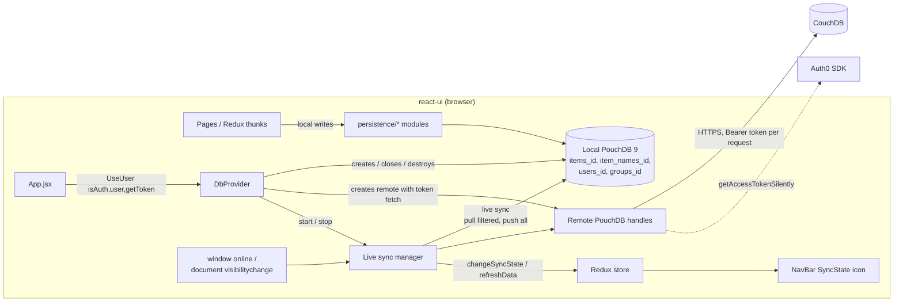
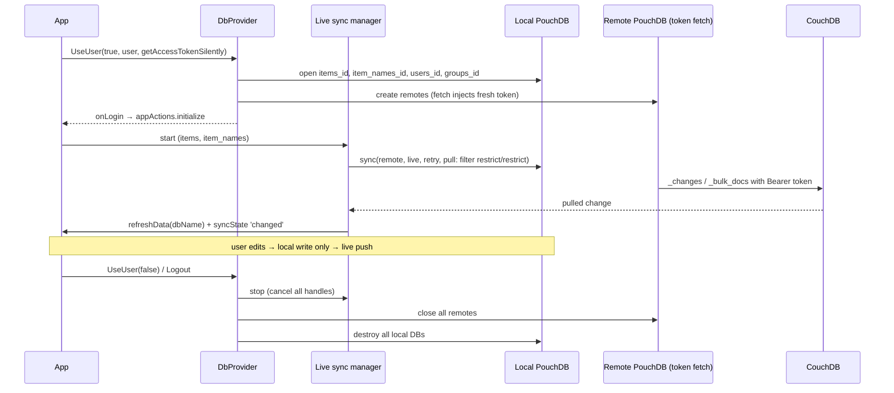

# Modernization Phase 4: Data Layer (PouchDB 9 + Sync Fixes) Plan

**Plan Status**: `FINAL`

**Story Type**: `Internal`

> This plan captures **what** to build and **why** — domain, architecture, decisions, and verified facts.
> It deliberately does **not** contain implementation code, pseudocode, line numbers, mock setups, or test bodies.
> The implementation agent discovers the **how** against live code. See §4 Task Breakdown.

---

## 1. Problem Statement

*   **Context**: After Phase 3 (#28, PR #51, merged as `4af5441`), `react-ui` runs on React 19, React Router 7, `@auth0/auth0-react` v2 and RTK 2. The data layer is unchanged since the original app:
    *   `pouchdb` **7.3.1** is installed (`^7.2.1` in `react-ui/package.json`), together with `pouchdb-debug` 7.2.1 and `pouchdb-upsert` 2.2.0. `src/persistence/index.js` turns on `PouchDB.debug.enable('*')` unconditionally, so every PouchDB call logs in production.
    *   `DbProvider.Login` gets **one** access token and stores it in `this.opts.headers.Authorization`. The remote PouchDB instances are created with these fixed headers. The token is never refreshed, so replication stops silently when it expires (#22).
    *   `DbProvider.Logout` closes `remote.itemNames`, but the key is `item_names`, so that remote is never closed (#21). Local databases `users_<id>`, `items_<id>`, `item_names_<id>` and `groups_<id>` are neither closed nor destroyed, so the previous user's data stays in IndexedDB (#23).
    *   `persistence/items.js` (`add`, `changeState`, `changeQuantity`, `update`) and `persistence/itemNames.js` (`add`) write locally, **and** directly to the remote table, **and** then call `syncMonkey.reset()`, which replicates local → remote again. This causes revision conflicts and fails when offline (#24). `categories.js`, `groups.js` and `users.js` write locally only.
    *   Sync is the `syncMonkey` singleton (`src/common/syncMonkey.js`). It is a `setTimeout` poller with backoff from 1 s to 5 min. It calls `DbProvider.replicate('item_names')` and then `replicate('items')`, which do a one-shot filtered pull (`restrict/restrict`, `query_params` `{groups:[groupId]}`) and then an unfiltered push. `syncMonkey.reset()` is called during render from `MainContent`, `AddItem` and `BrowseItems`, and `index.jsx` installs `mousemove`/`touchmove` wake-up hooks. Replication logs `console.log('XXX ...')` lines.
    *   `appActions.changeSyncState` and the `SyncState` NavBar icon (`ok` / `changed` / `error` / `disabled`) exist, but **nothing dispatches a sync state**, so the icon is always `ok`.
*   **Goal**: The app runs on PouchDB 9. `items` and `item_names` sync continuously through PouchDB live sync, with a fresh Auth0 token on every remote request. Mutations write locally only. Logout fully tears down remote and local databases. The sync icon shows the real state. Debug logging is off by default.
*   **Owner direction (issue comment, 2026-10-20)**: "Move to live sync, ignore existing user data." This settles the issue's open decision: task 4.6 is **in scope**. Compatibility of existing IndexedDB data (the check in 4.1) is **not** required.
*   **In scope**: tasks 4.1–4.7 (#21, #22, #23, #24).
*   **Out of scope**: server changes (Phase 5, #30), new CouchDB design docs or server-side filters, syncing `users`/`groups`/`categories` (they are never replicated today; see D2), TypeScript.

### 1.1 Technical Summary

*   **Touched projects**: `react-ui` only (`package.json`, lockfile, `vite.config.mjs` if `global` is no longer needed, `src/persistence/**`, `src/common/**`, `src/index.jsx`, `src/App.jsx`, `src/pages/{MainContent,AddItem,BrowseItems}.jsx`, `src/logic/appstate/actions.js`, `src/tests/**`). README tech list.
*   **New patterns / abstractions**:
    *   A **live sync manager** (new module under `src/persistence/`). It owns one live `sync` handle per synced database, connectivity triggers, and the mapping from sync events to Redux sync state. It replaces `syncMonkey` and `DbProvider.replicate`.
    *   A **token-injecting `fetch`** for remote PouchDB instances. It asks the Auth0 SDK for a token on every request.
    *   A small **debug-gated logger** (`src/common/logger.js`).
*   **Infrastructure changes**: None. Same CouchDB URL (`VITE_COUCH_URL`), same remote database names, same `restrict/restrict` filter and `query_params`.
*   **End-state observable behavior**:
    *   An edit on device A appears on device B within seconds while both are online, with no page reload.
    *   An edit made offline is pushed after the browser comes back online.
    *   Sync keeps working past access-token expiry.
    *   Logout leaves no `*_<userId>` IndexedDB databases behind.
    *   The NavBar sync icon reflects `ok` / `changed` / `error` / `disabled`.
    *   With debug off, the console shows no `XXX` lines or PouchDB debug output.

---

## 2. Architecture & Design

### 2.1 Architecture Overview

#### Involved services & owners

| Service | Technical Owner |
| :--- | :--- |
| `react-ui` (SPA / PWA) | @bcichonski |
| CouchDB at `VITE_COUCH_URL` (prod: `expiguard.bartq.toh.info`) | @bcichonski (not changed here) |
| Auth0 tenant (`VITE_AUTH0_*`) | @bcichonski (not changed here) |

#### C2 diagram

#### Flow diagram

### 2.2 External Contracts & Evidence

N/A — Internal story. CouchDB endpoints, database names, the `restrict/restrict` filter and its `query_params` are used exactly as the code uses them today. No new external API is called. The PouchDB 9 API is a library dependency. The implementation agent verifies it against the installed package source (see §3 D3/D4); it is not an external contract.

#### Source Conflict Log

| Topic | Source A | Source B | Conflict | Chosen Handling |
| :--- | :--- | :--- | :--- | :--- |
| Sync model | Issue: 4.6 "Optional", open decision | Owner comment 2026-10-20: "Move to live sync" | Optional vs required | Owner comment wins: live sync is in scope (D1). |
| IndexedDB compatibility | Issue 4.1 / Risk: test against a copy of real IndexedDB data | Owner comment: "ignore existing user data" | Verify vs skip | Skip the compatibility check. Local DB names stay unchanged, and data re-syncs from CouchDB anyway (D5). |
| Logout data policy | `doc/modernization-plan.md` §6.4 / #23: destroy or keep, undecided | #23 title frames retained data as a **bug** | Undecided | Destroy on logout (D6). |
| Exit criterion | Issue: verified against the real CouchDB across two devices | Sandbox cannot reach the CouchDB host (`doc/modernization-plan.md` §6.6) | Cannot be met in this run | Automated tests use two in-memory PouchDBs to simulate two devices. The real-server check is a manual step listed in the PR (D9). |

### 2.3 Affected Areas

| Area / File (pointer) | Role in this change | Likely action |
| :--- | :--- | :--- |
| `react-ui/package.json`, `package-lock.json` | PouchDB 7 → 9, drop `pouchdb-debug`, `pouchdb-upsert` latest, memory adapter for tests | Change |
| `react-ui/src/persistence/index.js` | Plugin registration and the global `PouchDB.debug.enable('*')` | Change |
| `react-ui/src/persistence/DbProvider.js` | Login/Logout, remote creation with fixed headers, `replicate`, `resetReplication`, `dbSyncState` | Change (token fetch, teardown; replication moves out) |
| `react-ui/src/persistence/items.js`, `itemNames.js` | Direct remote writes and `syncMonkey.reset()` | Change (local only) |
| `react-ui/src/persistence/categories.js`, `groups.js`, `users.js` | Already local only | Reference (confirm) |
| `react-ui/src/common/syncMonkey.js` + `src/tests/common/syncMonkey.test.js` | Polling sync | Delete |
| New: `react-ui/src/persistence/<live sync module>` | Live sync manager | New |
| New: `react-ui/src/common/logger.js` | Debug-gated logger | New |
| `react-ui/src/index.jsx` | `syncMonkey.setWakeUpHooks` (mousemove/touchmove) | Change (remove) |
| `react-ui/src/pages/MainContent.jsx`, `AddItem.jsx`, `BrowseItems.jsx` | `syncMonkey.reset()` called during render | Change (remove) |
| `react-ui/src/logic/appstate/actions.js` | `initialize` calls `syncMonkey.start()`; `syncChanges` refresh thunk | Change (start live sync) |
| `react-ui/src/App.jsx` | Builds `syncHooks` (`changeSyncState`, `refreshData`) and passes `getAccessTokenSilently` | Reference (probably unchanged) |
| `react-ui/src/components/NavBar.jsx`, `SyncState.jsx`, `logic/appstate/reducers.js` | Show the sync state | Reference (state values unchanged) |
| `react-ui/vite.config.mjs` | `define: { global: 'globalThis' }` added for PouchDB 7 | Change only if PouchDB 9 no longer needs it |
| `react-ui/src/tests/**` (DbProvider, store, App, page tests that mock `syncMonkey`) | Tests that mock or characterize the old sync | Change |
| `README.md` (tech list), `doc/modernization-plan.md` | Docs | Change (tech list only) |

### 2.4 Key Algorithms & Behaviour

**Live sync (per synced DB: `items`, `item_names`)**
*   The sync is bidirectional and live, with retry. **Pull** is filtered with the same server filter as today (`restrict/restrict`, with the same `query_params` as `DbProvider.Login` builds: `{groups: [groupId]}`). **Push** is unfiltered, as today. A single `sync` call with per-direction `pull` options is preferred. If PouchDB 9's `sync` does not apply per-direction options, use two live `replicate` handles (from / to). Either way, a push must never send the remote filter name to the local DB.
*   Retry backoff: start ~1 s, grow geometrically, cap at **5 min** (same bounds as `syncMonkey`), with small jitter.
*   Event → effect mapping:
    *   Pull `change` with docs → `syncHooks.refreshData(dbName)` (the existing `appActions.syncChanges` thunk) and sync state `changed`.
    *   `paused` with no error → `ok`. `paused` with an error, `error`, or `denied` → `error`.
    *   `active` → no state change (avoid flicker).
    *   Sync state is global, not per DB: `error` wins over `changed`, and `changed` wins over `ok`.
*   **Connectivity triggers**: `window` `online`, and `document` `visibilitychange` to `visible`, restart any handle that has stopped (cancelled, errored or completed). A handle that is live and healthy is never restarted. `offline` sets the state to `disabled`, and the next `online` clears it. All listeners are removed on stop.
*   **Idempotency**: `start` while already running does nothing (StrictMode double effects; repeated `initialize`). `stop` while stopped does nothing. `stop` cancels every handle and detaches every listener.
*   The pull-side `change` handler must not call `refreshData` after `stop`, for example when an event arrives after logout.

**Token per request (#22)**
*   The remote PouchDB instances get a custom `fetch`. Each request asks the Auth0 SDK (`getAccessTokenSilently`, the function `App` already passes into `UseUser`) for a token, sets `Authorization: Bearer <token>` on that request, and delegates to PouchDB's own fetch. The SDK caches tokens and renews them before expiry, so this is cheap. No fixed `Authorization` header is stored on `DbProvider` any more.
*   On an HTTP **401**, the fetch gets a token once more, bypassing the SDK cache, and retries that request **once**. A second 401, or a token failure (for example `login_required`), returns the 401 to PouchDB. The sync state then becomes `error`. The next connectivity trigger restarts the sync.
*   After logout, the fetch must not use a getter from the previous user. A request issued after `Logout` fails fast instead of attaching a token.

**Logout teardown (#21, #23)**
*   The order is:
    1.  Stop the live sync.
    2.  Close every remote (`users`, `items`, `item_names`, `groups`), using the correct keys.
    3.  Destroy every local DB (`users_<id>`, `items_<id>`, `item_names_<id>`, `groups_<id>`).
    4.  Clear `local` / `remote` / `userId` / the token getter.
*   The existing concurrency rules stay: the `authGeneration` bump, `logged` flipped before awaiting, a login racing a logout. A failure to close or destroy one DB is logged and does not stop the others from being torn down.
*   Offline edits that were not pushed are discarded on logout (D6).

**Local-only writes (#24)**
*   `items.*` and `itemNames.add` write only to the local DB, and their upsert semantics stay unchanged. Live sync pushes the change. No persistence module touches `remote` any more.

**Logger (4.7)**
*   `debug`/`info` are emitted only when debug is enabled: Vite `DEV`, or a `localStorage` flag (D8). `warn`/`error` are always emitted.
*   It replaces the `XXX` replication logs, the `syncMonkey` "wake up" logs, the "already in progress" log, and the global `PouchDB.debug.enable('*')`.

---

## 3. Key Decisions & Assumptions

*   **D1 — Live sync replaces `syncMonkey`.** The owner decided this on 2026-10-20. `syncMonkey`, `DbProvider.replicate`, `resetReplication`, `dbSyncState`, the mousemove/touchmove wake-up hooks and every `syncMonkey.reset()` call (in render and in persistence) are removed.
*   **D2 — Only `items` and `item_names` are synced.** Today only these two DBs are replicated. `users`, `groups` and `categories` stay local only, and their remotes are still created (and now closed) as today. Syncing them would change server-side behaviour and is out of scope.
*   **D3 — PouchDB 9 via the `pouchdb` package.** Keep the same import (`import PouchDB from 'pouchdb'`) and let the bundler pick the browser build. Keep the default browser adapter (`idb`). Do **not** switch to the newer `indexeddb` adapter: that would be a storage-format change for no gain here. The agent checks PouchDB 9's `sync` options, `fetch` option, `PouchDB.fetch` and event names against the installed package source and release notes, and records any API difference it hits in the task Notes.
*   **D4 — Upsert plugin.** Keep `pouchdb-upsert` at its latest version (2.2.0). Confirm that `upsert`/`putIfNotExists` still work on PouchDB 9 with a test against a real in-memory PouchDB 9. If the plugin is broken on 9, replace its two methods with a small local helper that has the same semantics; no API change for callers.
*   **D5 — No IndexedDB compatibility work.** The owner said "ignore existing user data". Local DB names stay `<table>_<userId>`. Old IndexedDB data is not migrated and not tested. If PouchDB 9 can't open an old local DB, the data comes back from CouchDB on the next sync, and logout (D6) clears it anyway.
*   **D6 — Destroy local DBs on logout.** #23 calls retained data a bug, and the landing page's legal note promises data per device only while you're logged in. Shared-device privacy wins over startup speed. Trade-off: edits made offline and not yet pushed are lost on logout. This is accepted under the owner's "ignore existing user data" stance and flagged in the PR.
*   **D7 — 401 handling is local to the fetch wrapper.** One forced token refresh and one retry per request. No unbounded retry loop. PouchDB's own `retry` backoff covers network errors.
*   **D8 — Logger gate.** Debug output is on when `import.meta.env.DEV` is true or `localStorage['expiguard:debug'] === '1'`. Reading the flag is wrapped in `try`/`catch` (private mode). `PouchDB.debug` is removed together with `pouchdb-debug`.
*   **D9 — Verification without the real CouchDB.** The sandbox can't reach the CouchDB host. "Two devices" is simulated in tests by two local in-memory PouchDB 9 instances syncing through a shared in-memory "remote" (`pouchdb-adapter-memory`, devDependency only). Real-server checks are listed in the PR as a manual step: two devices, token expiry, offline → online.
*   **Assumption A1** (non-blocking): the server-side `restrict/restrict` filter design doc and the `query_params` shape are unchanged. Nothing in this story touches them, so the existing pull contract holds.
*   **Assumption A2** (non-blocking): the Auth0 SDK's `getAccessTokenSilently` renews an expired access token silently using the existing SDK defaults (memory cache, no refresh tokens, iframe silent auth). Phase 3 (PR #51) left these defaults unchanged. If the tenant session itself expires, the token call fails, the sync state shows `error`, and the user logs in again. That is the expected outcome.

### 3.1 Decision Lock (Constants & Policies)

| Constant / Policy | Selected Value | Why | Where it lives |
| :--- | :--- | :--- | :--- |
| Synced DBs | `items`, `item_names` | Same as today (D2) | Live sync manager |
| Pull filter | `restrict/restrict`, `query_params {groups: [groupId]}` | Unchanged server contract | DbProvider remote metadata |
| Push filter | none | Unchanged | Live sync manager |
| Retry backoff | ~1 s start, cap 5 min, jitter | Same bounds as `syncMonkey` | Live sync manager |
| 401 policy | one forced token refresh + one retry per request | D7 | Remote fetch wrapper |
| Restart triggers | `online`; `visibilitychange` → visible | Issue 4.6 | Live sync manager |
| Sync state values | `ok` / `changed` / `error` / `disabled` | Existing reducer and icon | Redux `appstate` |
| Logout policy | stop sync → close remotes → destroy locals | D6, #21, #23 | `DbProvider.Logout` |
| Local DB names | `<table>_<userId>` (unchanged) | D5 | `DbProvider.Login` |
| Browser adapter | PouchDB default (`idb`) | D3 | — |
| Debug flag | `import.meta.env.DEV` or `localStorage['expiguard:debug']==='1'` | D8 | `src/common/logger.js` |

### 3.2 Open Questions

No open questions.

Resolution record:
*   *Sync model*: closed by the owner comment (2026-10-20).
*   *IndexedDB compatibility*: closed by the same comment.
*   *Logout data policy*: closed as D6. #23 frames retained data as a defect, and the owner's comment de-prioritises preserving local data.
*   *Is CouchDB reachable*: this doesn't affect correctness of the design. It only affects the manual exit check, handled in D9.

---

## 4. Task Breakdown

All tasks touch `react-ui/package.json` or shared persistence files, so they run **sequentially**. Concurrent npm runs on this workspace corrupt the lockfile (see the project memory notes).

| Task | Title | Depends on | Complexity |
| :--- | :--- | :--- | :--- |
| `T1` | PouchDB 9 upgrade + debug-gated logger | — | `Medium` |
| `T2` | Local-only writes in persistence modules | `T1` | `Low` |
| `T3` | Logout teardown: fix remote key, close + destroy local DBs | `T2` | `Medium` |
| `T4` | Per-request Auth0 token for remote PouchDB (+401 retry) | `T3` | `High` |
| `T5` | Live sync manager replaces `syncMonkey`; sync state wired to NavBar | `T4` | `High` |
| `T6` | Exit sweep: docs, dead-code greps, full verification | `T5` | `Low` |

### T1 — PouchDB 9 upgrade + debug-gated logger

*   **Goal**: `react-ui` builds and tests on `pouchdb` 9.x. `pouchdb-debug` is gone, and replication noise goes through a debug-gated logger.
*   **Depends on**: `—`.
*   **Complexity**: `Medium`.
*   **Pointers**: `react-ui/package.json`, `src/persistence/index.js`, `src/persistence/DbProvider.js` (`XXX` logs, "already in progress"), `src/common/syncMonkey.js` (wake-up log; the file itself is deleted in T5), `vite.config.mjs` (`define.global` comment says it is for PouchDB 7), new `src/common/logger.js`.
*   **Definition of Done**:
    *   `pouchdb` `^9`; `pouchdb-upsert` at latest.
    *   `pouchdb-debug` uninstalled, and `PouchDB.debug.enable` removed.
    *   `pouchdb-adapter-memory` `^9` added as a **devDependency** only, for T2–T5 tests.
    *   Lockfile regenerated with a clean `npm ci`, without `--legacy-peer-deps`.
    *   `define.global` kept or removed according to whether the PouchDB 9 browser build still needs it. Either way, the comment says why.
    *   `logger.js` implements D8. No `console.log('XXX` is left in `src`.
    *   `vite build` succeeds, and the bundle still includes the PouchDB browser build, not the Node/leveldown build.
*   **Tests expected**: unit tests for the logger gate (DEV on/off, localStorage flag, localStorage throwing), and a smoke test that a real PouchDB 9 (memory adapter) supports `putIfNotExists` and `upsert` through the registered plugin (D4). The existing suite stays green.

### T2 — Local-only writes in persistence modules

*   **Goal**: No persistence module writes to a remote DB. Mutations are local only (#24).
*   **Depends on**: `T1`.
*   **Complexity**: `Low`.
*   **Pointers**: `src/persistence/items.js`, `itemNames.js`; confirm `categories.js`, `groups.js`, `users.js`.
*   **Definition of Done**: every `remote` reference is removed from the persistence modules. Upsert / `putIfNotExists` semantics (field-diff logic, `changed_timestamp`, `previous_quantity`, `_deleted` revive in `itemNames.add`) are unchanged. `syncMonkey.reset()` calls in these modules may stay until T5 removes `syncMonkey`. Writes succeed with no remote configured, which stands in for offline.
*   **Tests expected**: unit tests against an in-memory PouchDB 9 local DB with a provider stub that has **no** remote. Cover `items.add` / `changeState` / `changeQuantity` / `update`, the existing diff semantics, and that `itemNames.add` revives a deleted name. Assert that no remote object is touched.

### T3 — Logout teardown: fix remote key, close + destroy local DBs

*   **Goal**: logout closes all four remotes and destroys all four local DBs (#21, #23, D6). The Phase-3 login/logout concurrency guarantees still hold.
*   **Depends on**: `T2`.
*   **Complexity**: `Medium`.
*   **Pointers**: `src/persistence/DbProvider.js` (`Logout`, `Clear`, `Login`), `src/tests/persistence/DbProvider.test.js`, `src/tests/AppStrictMode.test.jsx`, `src/pages/LandingPage.jsx` (calls `Logout`).
*   **Definition of Done**:
    *   `remote.item_names` is closed.
    *   Local DBs are destroyed after the remotes close. Teardown keeps going when one close or destroy rejects (the error is logged).
    *   `local`, `remote` and `userId` are cleared.
    *   A repeated or concurrent `Logout` is safe.
    *   A login that starts while teardown is running isn't lost, and doesn't get its new DBs destroyed by the old teardown. Destroy only the DB instances captured at the start of logout.
    *   T5 adds a hook for stopping the sync; T3 leaves a clear place for it.
*   **Tests expected**: unit tests covering:
    *   every remote and local is closed or destroyed, including `item_names`;
    *   one failing destroy doesn't stop the others;
    *   double logout;
    *   logout racing a new login (the new user's DBs survive);
    *   the existing StrictMode login/logout tests still pass.

### T4 — Per-request Auth0 token for remote PouchDB (+401 retry)

*   **Goal**: remote requests always carry a fresh token from the Auth0 SDK, so sync survives token expiry (#22, D7).
*   **Depends on**: `T3`.
*   **Complexity**: `High` (auth-critical; concurrency with login/logout).
*   **Pointers**: `src/persistence/DbProvider.js` (`opts.headers`, `CreateRemoteDb`, `useUserAsync` / `loginWithTokenAsync`, `Login(user, token)`), `src/App.jsx` (passes `getAccessTokenSilently`), `src/tests/persistence/DbProvider.test.js`, `src/tests/AppStrictMode.test.jsx`. Check PouchDB 9's `fetch` constructor option and `PouchDB.fetch`, and the Auth0 SDK's `cacheMode: 'off'` option, in the installed sources.
*   **Definition of Done**:
    *   Remotes are created with a fetch wrapper that sets `Authorization: Bearer <token>` from the stored getter on each request. No fixed `Authorization` header is stored.
    *   On a 401 there is one forced refresh (cache bypass) and one retry.
    *   After logout the getter is cleared, and wrapper calls fail fast without a token.
    *   Login still awaits one token up front, so a user without a valid session never logs in. The Phase-3 test contracts are kept: one `getToken` call on racing logins, and a retry after a token failure. If a public signature changes (for example `Login(user, token)`), update its callers and tests to match.
*   **Tests expected**: unit tests with a stubbed `PouchDB.fetch` / global fetch covering:
    *   the token is attached per request, and a changed token is picked up on the next request;
    *   401 → refresh with cache off → retry succeeds;
    *   401 twice → the 401 is surfaced;
    *   the getter throws → error surfaced, no header;
    *   after logout → no token is requested.

### T5 — Live sync manager replaces `syncMonkey`; sync state wired to NavBar

*   **Goal**: continuous bidirectional sync for `items` and `item_names`, with connectivity triggers and a real sync-state icon (4.6, D1). Polling and the render-time resets are gone.
*   **Depends on**: `T4`.
*   **Complexity**: `High` (concurrency, lifecycle under StrictMode, data correctness).
*   **Pointers**:
    *   New live sync module under `src/persistence/`.
    *   `src/persistence/DbProvider.js`: remove `replicate` / `resetReplication` / `dbSyncState`, add start/stop wiring, and stop the sync first in `Logout` (T3 hook).
    *   `src/logic/appstate/actions.js` (`initialize`).
    *   `src/index.jsx` (wake-up hooks).
    *   `src/pages/MainContent.jsx`, `AddItem.jsx`, `BrowseItems.jsx` (`syncMonkey.reset()` in render).
    *   `src/persistence/items.js`, `itemNames.js` (leftover resets).
    *   Delete `src/common/syncMonkey.js` and `src/tests/common/syncMonkey.test.js`.
    *   Tests that `vi.mock('../common/syncMonkey')`: `BrowseItems`, `store`, and others found by grep.
*   **Definition of Done**:
    *   §2.4 live sync behaviour is implemented: pull filtered / push unfiltered, backoff capped at 5 min, event → state mapping, `refreshData` on pulled changes, `online` / `visibilitychange` restart, `offline` → `disabled`, idempotent start/stop, and no callbacks after stop.
    *   Sync starts after `initialize` loads local data and stops on logout.
    *   No `syncMonkey` reference is left anywhere in `src`.
    *   The NavBar icon changes with sync state.
    *   No new console warnings under StrictMode. The all-routes smoke test still passes.
*   **Tests expected**:
    *   Unit tests with fake handles for:
        *   event → state mapping and precedence;
        *   start/stop idempotency (StrictMode double start);
        *   triggers restart only stopped handles;
        *   listeners removed on stop;
        *   no `refreshData` after stop.
    *   An integration-style test with real PouchDB 9 on the memory adapter: two local DBs (device A and device B) each live-synced to one shared in-memory "remote". An item written on A shows up on B and triggers B's `refreshData`. The pull filter must be stubbed or replaced for the in-memory remote, for example with a filter design doc created in that remote. Pushing never needs a local filter.
    *   Store / initialize tests are updated to assert the sync starts.

### T6 — Exit sweep: docs, dead-code greps, full verification

*   **Goal**: the phase's exit state is verified and documented as far as the sandbox allows.
*   **Depends on**: `T5`.
*   **Complexity**: `Low`.
*   **Pointers**: `README.md` tech list, `doc/modernization-plan.md` (Phase 4 status note if the file tracks status), `react-ui/vite.config.mjs` comment.
*   **Definition of Done**:
    *   README lists PouchDB 9 / live sync.
    *   The §5 greps come back empty.
    *   Clean `npm ci`, root production build, full test suite, and lint with 0 errors all pass.
    *   `vite preview` loads `/welcome` with no console errors.
    *   The manual real-CouchDB checklist (D9) is written down so it can go into the PR body.
*   **Tests expected**: none new beyond fixing stragglers. The full suite runs.

---

## 5. Verification

*   **Install**: `cd react-ui && npm ci`: clean, without `--legacy-peer-deps`. `npm ls pouchdb` shows a single 9.x.
*   **Build**: `NODE_ENV=production npm run build` at the repo root succeeds, and the service worker is generated.
*   **Tests**: `cd react-ui && npm test`: all green, including the new logger, persistence, DbProvider, token-fetch and live-sync tests.
*   **Lint**: `cd react-ui && npm run lint`: 0 errors.
*   **Greps** (in `react-ui/src`), each empty: `syncMonkey`, `XXX`, `pouchdb-debug`, `PouchDB.debug`, `remote_table.put`, `remote_table.upsert`, `itemNames)` in `Logout` (the old wrong key), `opts.headers.Authorization`.
*   **Server**: `node --check server/index.js` passes (untouched).
*   **Manual, outside the sandbox (PR checklist)**, against the real CouchDB:
    *   Two devices: an edit on A appears on B without a reload.
    *   Offline → online: an offline edit is pushed after reconnecting.
    *   Token expiry: sync continues after the access token expires, for example in a long-lived tab or with a short token lifetime on a test tenant.
    *   Logout: no `*_<userId>` databases remain in DevTools → IndexedDB.
    *   The sync icon shows `error` while the server is unreachable.

---

## 6. Fact-Integrity Checklist

| Check | Yes / No / N/A | Notes |
| :--- | :--- | :--- |
| External contracts (routes, payload type ids, DTO fields, identifier types) verified from producer/contract source — not story text | N/A | Internal story; the CouchDB filter / DB names are used unchanged from current code |
| Evidence sources are reproducible (exact repo file path/symbol) | N/A | Internal |
| Identifier directionality / ordering / freshness **meaning** evidenced separately from field shape, or moved to an Open Question | N/A | Internal |
| Every `Assumption` is linked to an Open Question (§3.2) | Yes | A1/A2 are non-blocking: they restate unchanged behaviour from merged code (PR #51) and need no OQ |
| No unresolved Open Questions (for `FINAL`) | Yes | Resolved by the owner comment and D6/D9 |
| Each Decision states a single committed approach | Yes | D3 names a fallback (two `replicate` handles) only if PouchDB 9's `sync` doesn't apply per-direction options. Push stays unfiltered either way |
| Tasks are independent, each with a Definition of Done and test expectations | Yes | Sequential on purpose (shared lockfile / DbProvider) |
| Required infra reflected: toggle-gated where the story carries a toggle key; new Service Bus subscription/queue ⇒ a task updates `infrastructure.bicep` | N/A | No toggle key; no server infra |

**Self-review note**: The main uncertainties are PouchDB 9 API details: per-direction `sync` options, the `fetch` option and `PouchDB.fetch`, and whether `pouchdb-upsert` still works. The agent must check these against the installed package, not memory. The design doesn't depend on which of the two sync shapes is used. Take extra care with the lifecycle under StrictMode and login/logout races (T3–T5). Destroying the wrong user's DBs, or a sync callback dispatching after logout, are the costly failure modes. The real-CouchDB exit criteria can't be run in the sandbox and are deferred to a manual PR checklist (D9).
