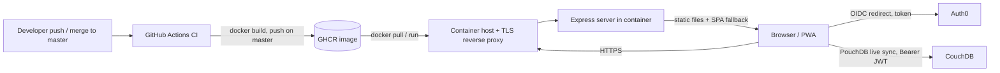
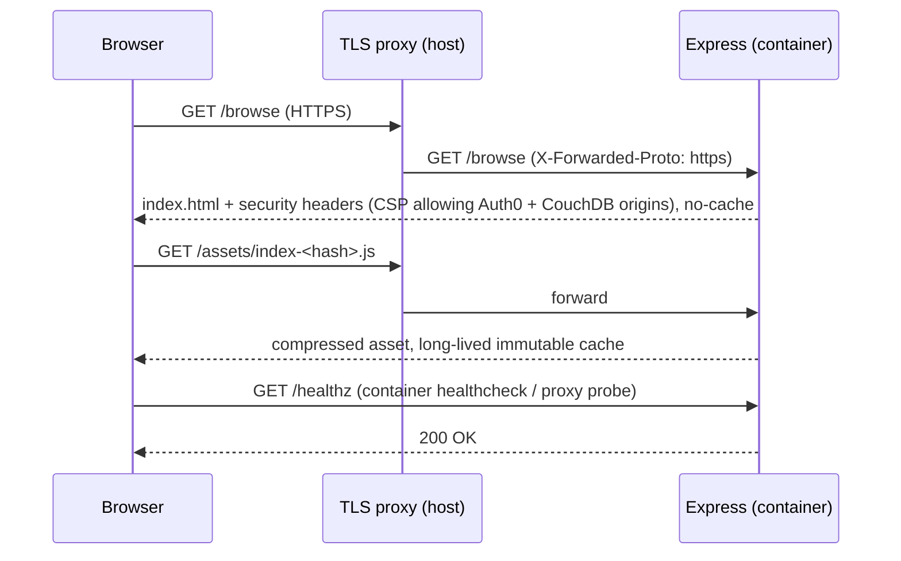

# Modernization Phase 5: Server and Hosting (Docker) Plan

**Plan Status**: `FINAL`

**Story Type**: `Internal`

> This plan captures **what** to build and **why** — domain, architecture, decisions, and verified facts.
> It deliberately does **not** contain implementation code, pseudocode, line numbers, mock setups, or test bodies.
> The implementation agent discovers the **how** against live code. See §4 Task Breakdown.

---

## 1. Problem Statement

*   **Context**: The app is still shaped for Heroku. Heroku free dynos ended in Nov 2022, so the README demo link (`https://bcexpiguard.herokuapp.com`) is dead. `app.json` is a Heroku manifest, and the root `package.json` keeps Heroku-only keys (`cacheDirectories`, the `heroku` keyword). `server/index.js` runs Express 4 and uses the deprecated `cluster.isMaster` to fork one worker per CPU. It always redirects to HTTPS, serves `react-ui/build`, and still has a placeholder `/api` route. It has no tests, health endpoint, security headers, compression or graceful shutdown. `.gitignore` ignores `Dockerfile` and `docker-compose.yml`, so container files cannot be committed. CI (`.github/workflows/ci.yml`) only runs `node --check` on the server.
*   **Goal**: Ship the app as a Docker container, per the owner's decision on #30 ("5B - ship as docker container", 2026-10-20). The modernized Express server serves the Vite build. CI builds the image on every PR and publishes it to GitHub Container Registry on every push to `master`.
*   **In scope**: tasks 5.1 (leave Heroku: remove `app.json` and Heroku-only package keys), 5.2B (server modernization), 5.3B (multi-stage Dockerfile, un-ignore Docker files), the CI image build and publish, 5.4 as documentation (Auth0 / CouchDB CORS checklist for the host's origin), and 5.5 (README demo link and screenshots).
*   **Out of scope**: option 5A (static hosting, task 5.2A); choosing or provisioning the machine that runs the container; changing the live Auth0 tenant or CouchDB server config (external systems this repo cannot reach; documented as a manual checklist); Phase 6 items such as the root `package.json` rename and the leftover template `repository` URL (#31).

### 1.1 Technical Summary

*   **Touched areas**: `server/` (Express app), root `package.json` / `package-lock.json`, new `Dockerfile`, `.dockerignore`, `docker-compose.yml`, `.gitignore`, `.github/workflows/`, `README.md`, new `doc/deployment.md`. `react-ui/` source is unchanged.
*   **New patterns / abstractions**: an Express app factory, separate from the process entry point, so tests can exercise it in-process. A security-header policy (helmet + CSP) built from the app's configured Auth0 and CouchDB origins. Root-level server tests using Node's built-in test runner.
*   **Infrastructure changes**: a container image published to `ghcr.io/bcichonski/bcexpiguard` from CI. Heroku manifest removed.
*   **End-state observable behaviour**: `docker run -p 5000:5000 ghcr.io/bcichonski/bcexpiguard` serves the SPA on `http://localhost:5000`. Deep links fall back to `index.html`, `GET /healthz` returns 200, and responses carry security headers and compression. A merge to `master` publishes a fresh image tagged `latest` and with the commit SHA.

---

## 2. Architecture & Design

### 2.1 Architecture Overview

#### Involved services & owners

| Service | Technical Owner |
| :--- | :--- |
| BcExpiGuard web container (Express + static Vite build) | bcichonski |
| Auth0 tenant `bcexpiguard.eu.auth0.com` (external; config change is manual) | bcichonski |
| CouchDB `https://expiguard.bartq.toh.info/` (external; CORS change is manual) | bcichonski |
| GitHub Actions + GHCR | bcichonski |

#### C2 diagram

#### Flow diagram

### 2.2 External Contracts & Evidence

`N/A — Internal story`. Auth0 and CouchDB are already integrated. This story adds no new API call; it only has to allow their existing origins in the CSP (origins verified from `react-ui/.env.production` and `doc/couchdb/README.md` §1).

#### Source Conflict Log

| Topic | Source A | Source B | Conflict | Chosen Handling |
| :--- | :--- | :--- | :--- | :--- |
| Hosting option | Issue body: "5A (recommended)" | Owner comment 2026-10-20: "5B - ship as docker container" | Recommendation vs owner decision | Owner comment wins: 5B. Task 5.2A is out of scope. |
| Build output dir | `doc/modernization-plan.md` mentions `react-ui/dist` | `react-ui/vite.config.mjs` `build.outDir: 'build'`; server serves `react-ui/build` | Doc predates the Vite migration | Live config wins: `react-ui/build`. |
| HTTPS enforcement | Current server always redirects to HTTPS | A container is commonly run behind a TLS-terminating proxy, or locally over plain HTTP | Unconditional redirect breaks `docker run` locally and the health probe | HTTPS redirect, HSTS and `upgrade-insecure-requests` are opt-in via `FORCE_HTTPS=true` (D4). |

### 2.3 Affected Areas

| Area / File (pointer) | Role in this change | Likely action |
| :--- | :--- | :--- |
| `server/index.js` | Process entry point: today it holds cluster, middleware and routes together. | Change: becomes a thin entry point (config, listen, graceful shutdown) |
| `server/app.js` (new; name at agent's discretion) | Express app factory: middleware, static files, `/healthz`, SPA fallback. | New |
| `server/*.test.js` or `server/tests/` (new) | Server behaviour tests (`node:test` + `supertest`). | New |
| root `package.json` / `package-lock.json` | Server deps (`express` 5, `helmet`, `compression`), dev dep `supertest`, `test` script. Heroku-only keys removed. | Change |
| `app.json` | Heroku manifest. | Delete |
| `.gitignore` | Ignores `Dockerfile` / `docker-compose.yml`. | Change: remove those entries |
| `Dockerfile`, `.dockerignore`, `docker-compose.yml` (new) | Multi-stage image build; local run. | New |
| `.github/workflows/ci.yml` | Existing CI; the `server` job only runs `node --check`. | Change: run server tests |
| `.github/workflows/docker.yml` (new; or a job in `ci.yml`) | Build the image on PR; push to GHCR on `master`. | New |
| `react-ui/.env.production` | Source of production `VITE_*` values. The server reads the same values at runtime for the CSP. | Reference |
| `react-ui/vite.config.mjs` | `build.outDir: 'build'`. A comment mentions Heroku. | Reference / comment touch-up |
| `README.md` | Dead Heroku demo link, "Hosting provided by Heroku", script docs. | Change |
| `doc/deployment.md` (new) | How to run the image, env vars, Auth0 and CouchDB CORS checklist for the deployed origin. | New |
| `doc/couchdb/README.md` | Already documents the CORS requirements. | Reference (link from deployment doc) |

### 2.4 Key Algorithms & Behaviour

**Request pipeline (order matters):**
1. `trust proxy` enabled so `req.secure` / `req.protocol` reflect `X-Forwarded-Proto` from the host's TLS proxy.
2. `GET /healthz` answers `200` with a tiny body (JSON or text) **before** any HTTPS redirect, so plain-HTTP probes from the container runtime / proxy always succeed. It does not read the filesystem.
3. HTTPS redirect (only when `FORCE_HTTPS=true`): non-secure requests get a 301/308 to the same host and path over `https`.
4. Security headers via `helmet`, with a CSP (see below). HSTS and `upgrade-insecure-requests` are emitted only when `FORCE_HTTPS=true`.
5. `compression`.
6. Static files from `react-ui/build`:
   *   Hashed assets under `/assets/` → long-lived `Cache-Control` (`public, max-age=31536000, immutable`).
   *   `index.html`, `service-worker.js`, `manifest.json` and other non-hashed files → must revalidate (`no-cache`), so a deploy reaches clients and the PWA update flow (`registerType: 'autoUpdate'`) keeps working.
7. SPA fallback: any remaining `GET`/`HEAD` that accepts HTML returns `index.html` (no-cache). Express 5 uses path-to-regexp v8, so the Express 4 `'*'` wildcard no longer works. The agent picks the Express 5-valid form. A request for a missing file-like path (e.g. `/missing.js`) should get 404, not `index.html`. This matches the Workbox `navigateFallbackDenylist` intent.
8. The `/api` placeholder is removed (no route; falls through like any other path).

**CSP (D5):** origins are derived at startup from configuration, never hard-coded in the server:
*   `default-src 'self'`; `script-src 'self'`; `style-src 'self' 'unsafe-inline'` (MUI/Emotion injects style tags at runtime); `font-src 'self' data:`; `img-src 'self' data: https:` (Auth0 `user.picture` avatars come from various HTTPS hosts — NavBar and Profile render them); `connect-src 'self'` + `https://<VITE_AUTH0_DOMAIN>` + origin of `VITE_COUCH_URL`; `frame-src https://<VITE_AUTH0_DOMAIN>` (Auth0 SPA SDK silent auth iframe); `worker-src 'self'`; `manifest-src 'self'`; `object-src 'none'`; `base-uri 'self'`; `frame-ancestors 'none'`.
*   Config source: the process environment (`VITE_AUTH0_DOMAIN`, `VITE_COUCH_URL`). If these are unset, they are loaded from `react-ui/.env.production` (Node's built-in env-file loader) so the image and `npm start` work with zero config. Already-set env vars win. The same values feed the Vite build, so build and runtime agree.
*   If a required origin is still missing after that, the server logs an error and starts with a CSP that omits it, rather than crashing. The CouchDB/Auth0 calls then fail visibly in the browser console.

**Process model (D3):** single process, no `cluster`. On `SIGTERM`/`SIGINT` the server stops accepting connections, closes the HTTP server and exits 0, with a short hard timeout. `docker stop` must not hang for the 10 s default. The listening port comes from `PORT` (default `5000`). The startup log names the port and whether HTTPS enforcement is on.

**Image (D6):** multi-stage on the Node 24 base (`.nvmrc` = 24).
*   The build stage installs `react-ui` deps with `npm ci` and runs `npm run build`. Vite picks up `react-ui/.env.production`. Optional `VITE_*` build args override it.
*   The runtime stage has root production deps only (`npm ci --omit=dev`), `server/`, `react-ui/build`, and `react-ui/.env.production` (public values, no secrets). It runs as the non-root `node` user with `NODE_ENV=production` and `EXPOSE 5000`.
*   `HEALTHCHECK` hits `/healthz` using Node's built-in `fetch`; the image has no curl.
*   `.dockerignore` keeps `node_modules`, `react-ui/node_modules`, `react-ui/build`, `.git`, `docs/`, `doc/` and local `.env*` overrides out of the context. `react-ui/.env.production` and `react-ui/.env.example` stay in.

**CI (D7):** on `pull_request` the image is built (no push) to prove the Dockerfile works. On `push` to `master` it is built and pushed to `ghcr.io/bcichonski/bcexpiguard` with tags `latest` and `sha-<short>`. It authenticates with the built-in `GITHUB_TOKEN` (`packages: write` on that job only), so no repo secrets are needed. The image name must be lowercase. The existing `server` CI job runs the new server tests instead of only `node --check`.

---

## 3. Key Decisions & Assumptions

*   **D1 — Option 5B (container).** The owner's comment on #30 overrides the issue's 5A recommendation. Static-host deploy (5.2A) is not built.
*   **D2 — Express 5, kept minimal.** Use `helmet`, `compression` and a `/healthz` route, and remove `/api`. No other middleware (no logging framework, no rate limiter): the server only serves static files.
*   **D3 — Drop clustering.** One process is enough for static files. Scaling belongs to the container runtime, and `cluster.isMaster` goes away without a replacement.
*   **D4 — HTTPS enforcement is opt-in (`FORCE_HTTPS=true`).** The container normally sits behind a TLS-terminating proxy and is also run locally over HTTP. An unconditional redirect, HSTS or `upgrade-insecure-requests` would break local runs and health probes. Deployment docs tell the operator to set it in production.
*   **D5 — CSP origins come from the `VITE_*` config,** falling back to `react-ui/.env.production`. There is a single source of truth for build and runtime, and nothing domain-specific is hard-coded in the server.
*   **D6 — The image ships the server and the static build only.** Dev deps and sources stay out. The process runs as non-root, and the health check uses Node's `fetch`.
*   **D7 — "Production deployed from CI on merge to `master`" is satisfied by publishing the image to GHCR on every push to `master`.** *Assumption*: the repo does not name a production host, and the sandbox has no access to one. Pulling the image on the host (manually, or with Watchtower or similar) is the operator's step and is documented in `doc/deployment.md`. Impact if wrong: the owner may want a deploy step to a specific host. That step is additive (one more job) and does not change anything built here. Recorded here and flagged in the PR rather than as a blocking open question.
*   **D8 — 5.4 (Auth0 / CouchDB CORS for the new domain) is documentation-only.** Those are live external configs that this repo cannot change. `redirect_uri` is `window.location.origin` (`Auth0ProviderWithNavigate.jsx`), so the code adapts to any origin automatically. `doc/deployment.md` lists exactly what to add: Allowed Callback URLs, Allowed Logout URLs and Allowed Web Origins in Auth0, plus the CouchDB `[cors] origins` entry (linking `doc/couchdb/README.md`).
*   **D9 — 5.5 README.** Remove the dead Heroku demo link and the "Hosting provided by Heroku" line. Point to the GHCR image and `doc/deployment.md` instead; no new public demo URL is invented. Check that the screenshot links (`doc/screenshots/screens.png`, `doc/screenshots/`) resolve, and leave the images unchanged. The untracked `doc/screenshots/cname.PNG` is the owner's local file and must not be committed or deleted.
*   **D10 — Server tests use `node:test` + `supertest`** (dev dependency of the root package). This adds no new test framework to the root, and `npm test` at the root runs them.

### 3.1 Decision Lock (Constants & Policies)

| Constant / Policy | Selected Value | Why | Where it lives |
| :--- | :--- | :--- | :--- |
| Default port | `5000` (`PORT` overrides) | Unchanged from the current server | `server/index.js`, `Dockerfile` `EXPOSE` |
| Health endpoint | `GET /healthz` → 200 | Issue task 5.2B | server app |
| HTTPS enforcement switch | env `FORCE_HTTPS=true` (default off) | D4 | server app, `doc/deployment.md` |
| Static root | `react-ui/build` | `vite.config.mjs` `outDir` | server app, Dockerfile |
| Hashed asset cache | `public, max-age=31536000, immutable` for `/assets/*` | Vite content-hashes these | server app |
| Non-hashed files cache | `no-cache` (`index.html`, `service-worker.js`, `manifest.json`, …) | PWA updates must propagate | server app |
| Image name | `ghcr.io/bcichonski/bcexpiguard` | GHCR requires lowercase | CI workflow, README, deployment doc |
| Image tags | `latest` + `sha-<short sha>` on `master` | Rollback by SHA | CI workflow |
| Base image | Node 24 (`node:24-alpine`) | `.nvmrc` = 24, `engines` ≥ 24 | Dockerfile |
| Runtime user | `node` (non-root) | Container hardening | Dockerfile |

### 3.2 Open Questions

No open questions.

Resolution attempts recorded: the hosting option was closed by the owner's comment (5B). The deploy target is closed by assumption D7 (no host named in the issue, the plan doc, the README or the repo; publishing to GHCR is the conservative reading of "deployed from CI"). The new domain is closed by D8/D9 (the code is origin-agnostic, so the exact domain is not needed in the repo).

---

## 4. Task Breakdown

| Task | Title | Depends on | Complexity |
| :--- | :--- | :--- | :--- |
| `T1` | Modernize Express server (Express 5, helmet/CSP, compression, `/healthz`, no cluster) + server tests; drop Heroku manifest | — | `Medium` |
| `T2` | Multi-stage Dockerfile, `.dockerignore`, `docker-compose.yml`; un-ignore Docker files | `T1` | `Medium` |
| `T3` | CI: run server tests; build image on PR, publish to GHCR on `master` | `T2` | `Medium` |
| `T4` | Docs: README (demo link, hosting, scripts) + `doc/deployment.md` (run, env vars, Auth0/CouchDB checklist) | `T3` | `Low` |

### T1 — Modernize Express server + tests; drop Heroku manifest

*   **Goal**: The server is an Express 5 single-process app. It has the request pipeline in §2.4 (healthz, opt-in HTTPS, helmet + CSP from config, compression, cache headers, SPA fallback, graceful shutdown) and an in-process test suite. Heroku leftovers are gone.
*   **Depends on**: `—`.
*   **Complexity**: `Medium`.
*   **Pointers**: `server/index.js`, new app-factory module in `server/`, root `package.json` / `package-lock.json`, `app.json`, `react-ui/.env.production`, `react-ui/vite.config.mjs` (only the "Heroku" wording in the `build.outDir` comment).
*   **Definition of Done**:
    *   `express` ^5 plus `helmet` and `compression` are dependencies, and `supertest` is a dev dependency. `package-lock.json` is regenerated with root `npm install`. Run npm only in the foreground and never in `react-ui` for this task.
    *   No `cluster` usage. `/api` placeholder removed. `/healthz` returns 200 before any redirect.
    *   `FORCE_HTTPS=true` enables the redirect, HSTS and `upgrade-insecure-requests`. When unset, none of the three is present.
    *   The CSP matches §2.4, with Auth0/CouchDB origins taken from env or, when env is unset, from `react-ui/.env.production`.
    *   Cache headers follow §3.1. SPA fallback returns `index.html` for unknown routes such as `/browse`. A missing file-like path such as `/nope.js` gets 404.
    *   SIGTERM/SIGINT closes the server and exits cleanly.
    *   `app.json` deleted. Root `package.json` loses `cacheDirectories` and the `heroku` keyword (leave `name`/`repository` for Phase 6). `start` / `build` scripts still work, and a `test` script runs the server tests.
    *   `npm test` (root) green. `npm run build` (root) still builds `react-ui/build`. `npm start` serves it locally on port 5000.
*   **Tests expected**: in-process HTTP tests (`node:test` + `supertest`) against the app factory, using a small temporary fixture static dir (or the real build if present; the tests must not depend on a prior `react-ui` build). Cover: healthz 200 without redirect; HTTPS redirect when forced and `X-Forwarded-Proto: http`, and no redirect when not forced; CSP header contains the configured Auth0 and CouchDB origins; HSTS present only when forced; deep-link fallback serves `index.html` with no-cache; hashed asset gets the immutable cache header; missing file-like path 404s; `/api` no longer returns the placeholder JSON; compression applied when `Accept-Encoding: gzip` is sent for a large enough asset.

### T2 — Dockerfile, `.dockerignore`, compose; un-ignore Docker files

*   **Goal**: `docker build .` produces a small, non-root image that serves the app and reports healthy.
*   **Depends on**: `T1`.
*   **Complexity**: `Medium`.
*   **Pointers**: new `Dockerfile`, `.dockerignore`, `docker-compose.yml` at repo root; `.gitignore`; `.nvmrc`; root and `react-ui` `package.json` scripts.
*   **Definition of Done**:
    *   The `Dockerfile` / `docker-compose.yml` entries are removed from `.gitignore`, and the new files are tracked by git.
    *   Multi-stage build per §2.4 D6: `react-ui` built in a build stage, and only production deps, `server/`, `react-ui/build` and `react-ui/.env.production` in the runtime stage. It runs as `node` with `NODE_ENV=production`, `EXPOSE 5000`, and a `HEALTHCHECK` on `/healthz` via Node `fetch`. Optional `VITE_*` build args are supported.
    *   `.dockerignore` excludes `node_modules` (both levels), `react-ui/build`, `.git`, `docs`, `doc`, and local env overrides (`*.local`); it keeps `react-ui/.env.production`.
    *   `docker-compose.yml` runs the image locally on port 5000 (builds from `.`), with `FORCE_HTTPS` left off.
    *   Verified locally if Docker is available: the image builds, `docker run` becomes `healthy`, and `curl` of `/`, `/healthz` and a deep link return 200 with the CSP header. Stop and remove the test container and image tag afterwards. If the Docker daemon is unavailable in the environment, note it in the report and rely on the CI build from T3.
*   **Tests expected**: no unit tests. The container smoke check above is the verification, recorded in the task report.

### T3 — CI: server tests + image build/publish

*   **Goal**: Every PR proves the server tests pass and the image builds, and every push to `master` publishes the image to GHCR.
*   **Depends on**: `T2`.
*   **Complexity**: `Medium`.
*   **Pointers**: `.github/workflows/ci.yml` (`server` job), new `.github/workflows/docker.yml` (or a new job in `ci.yml`, agent's choice, consistent with the existing style: `actions/checkout@v4`, top-level `permissions: contents: read`, concurrency group).
*   **Definition of Done**:
    *   The `server` CI job runs `npm ci` + `npm test` at the root, alongside the existing `node --check`, which can stay or go.
    *   The image job uses Docker's official actions (`docker/setup-buildx-action`, `docker/login-action`, `docker/metadata-action`, `docker/build-push-action`) with GitHub Actions cache. It builds on `pull_request` without pushing. On `push` to `master` it logs in to `ghcr.io` with `GITHUB_TOKEN` and pushes tags `latest` and `sha-<short>` to `ghcr.io/bcichonski/bcexpiguard`.
    *   `packages: write` is granted only to the image job.
    *   The workflow YAML is valid. Check it with a YAML parse; `actionlint` is optional if available.
*   **Tests expected**: none locally beyond YAML validity. The PR's own CI run is the real check (the PR run builds the image without pushing).

### T4 — Docs: README + deployment guide

*   **Goal**: The README no longer points at Heroku, and an operator can deploy the image and fix Auth0/CouchDB config for the new origin from the docs alone.
*   **Depends on**: `T3`.
*   **Complexity**: `Low`.
*   **Pointers**: `README.md`, new `doc/deployment.md`, `doc/couchdb/README.md` (link target), `react-ui/.env.example`.
*   **Definition of Done**:
    *   README: the Heroku demo link is replaced. Keep the icon and point it at the repo / deployment doc instead of a dead URL. The "Hosting provided by Heroku" line becomes Docker / GHCR. Root script docs reflect `npm start` / `npm run build` / `npm test`. There is a short "Run with Docker" section (`docker run` of the GHCR image, `docker compose up`), and the screenshot links resolve to existing files.
    *   `doc/deployment.md` covers:
        *   pulling and running the image behind a TLS proxy;
        *   env vars (`PORT`, `FORCE_HTTPS`, `VITE_AUTH0_DOMAIN`, `VITE_COUCH_URL`, and which are build-time vs runtime);
        *   updating on new `master` images (pull + restart, tag by SHA for rollback);
        *   the Auth0 checklist: Allowed Callback URLs, Allowed Logout URLs, Allowed Web Origins = the new origin;
        *   the CouchDB CORS checklist: add the new origin to `[cors] origins`, linking `doc/couchdb/README.md`.
    *   No secrets, and no invented production domain (placeholder like `https://<your-domain>`).
*   **Tests expected**: none. All relative links in the changed docs resolve to existing files.

---

## 5. Verification

*   **Server tests**: `npm test` at repo root — all green.
*   **Frontend**: `verify.sh --repo <repo>/react-ui` — build, Vitest suite, lint all PASS (frontend source is untouched; this is a regression check).
*   **Root build**: `npm run build` at repo root produces `react-ui/build`; `npm start` serves it on port 5000; `/healthz` 200; deep link `/browse` returns `index.html`.
*   **Container** (if Docker is available): `docker build -t bcexpiguard:local .`, `docker run -d -p 5000:5000` → health status `healthy`; `curl -I /` shows CSP with `bcexpiguard.eu.auth0.com` and `expiguard.bartq.toh.info`; cleanup afterwards.
*   **CI**: PR checks green, including the image build job (push skipped on PR).
*   **Manual (owner, post-merge)**: image appears in GHCR; deploy on host behind TLS with `FORCE_HTTPS=true`; Auth0 + CouchDB CORS updated for the host origin per `doc/deployment.md`; login + live sync work in a browser with no CSP violations in the console.

---

## 6. Fact-Integrity Checklist

| Check | Yes / No / N/A | Notes |
| :--- | :--- | :--- |
| External contracts (routes, payload type ids, DTO fields, identifier types) verified from producer/contract source — not story text | N/A | Internal story |
| Evidence sources are reproducible (exact repo file path/symbol) | N/A | Internal story |
| Identifier directionality / ordering / freshness **meaning** evidenced separately from field shape, or moved to an Open Question | N/A | Internal story |
| Every `Assumption` is linked to an Open Question (§3.2) | Yes | D7 (deploy target) is a non-blocking, additive assumption, closed with rationale in §3.2 and flagged in the PR |
| No unresolved Open Questions (for `FINAL`) | Yes | |
| Each Decision states a single committed approach | Yes | |
| Tasks are independent, each with a Definition of Done and test expectations | Yes | Sequential chain because they share `package.json`/Dockerfile/CI files |
| Required infra reflected: toggle-gated where the story carries a toggle key; new Service Bus subscription/queue ⇒ a task updates `infrastructure.bicep` | N/A | No toggle key, no messaging |

**Self-review note**: The main uncertainty is what "production deployed from CI" means without a named host. The plan publishes to GHCR (D7) and leaves the host pull to the operator. The owner may add a deploy job later. Take extra care with the CSP: too strict silently breaks Auth0 silent auth (`frame-src`), PouchDB sync (`connect-src`) or MUI styles (`style-src 'unsafe-inline'`). Too loose defeats the purpose. Also take care with Express 5's changed wildcard syntax in the SPA fallback. npm must run in the foreground only (virtiofs workspace; concurrent npm runs have corrupted lockfiles before).
